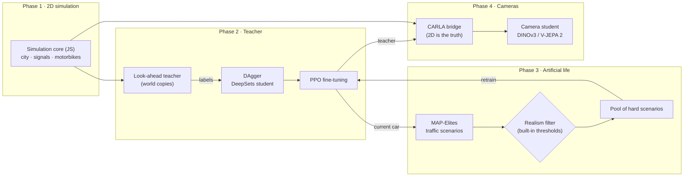

<div align="center">

<picture>
  <source media="(prefers-color-scheme: dark)" srcset="docs/logo/lotus-banner-dark.svg">
  
</picture>

**L**ook-ahead **O**racle **T**eaching in **U**rban **S**warms

**Teaching a self-driving car to move through Vietnamese motorbike traffic with reinforcement learning and artificial life.**

[](#-installation)
[](#-installation)
[](#-installation)
[](#phase-4--camera-student-in-carla)
[](#-run-the-full-pipeline)

**English** · [Tiếng Việt](README.vi.md)


</div>

**LOTUS** (the lotus is Vietnam's national flower) is a complete pipeline from simulation to a camera-only car. It starts with a **procedurally generated 2D city**: signalised junctions with countdown timers, unsignalised junctions, T-junctions, and hundreds of motorbikes that weave through gaps according to their own personalities. In that city, a **look-ahead teacher** is distilled into a neural network and fine-tuned with PPO. The motorbike population is then **co-evolved** to find situations that are hard yet still realistic. Finally, the knowledge is transferred to a **student that sees only through cameras**, inside CARLA.

<details open>
<summary><b>Contents</b></summary>

- [✨ Highlights](#-highlights)
- [🧭 Architecture](#-architecture)
- [📦 Installation](#-installation)
- [⚡ 5-minute smoke test](#-5-minute-smoke-test)
- [🚀 Run the full pipeline](#-run-the-full-pipeline)
- [📖 Step-by-step guide](#-step-by-step-guide)
- [⚙️ Configuration](#️-configuration)
- [📊 Results](#-results)
- [🗂️ Repository layout](#️-repository-layout)
- [❓ FAQ](#-faq)
- [🗺️ Roadmap](#️-roadmap)
- [📚 Citation and licence](#-citation-and-licence)

</details>

## ✨ Highlights

| | |
|---|---|
| 🏙️ **Procedural city** | Grids of 1×1 to 3×3 junctions, three road classes, signalised or unsignalised junctions, T-junctions. Every training scene is a new city, so the car learns to generalise instead of memorising one junction. |
| 🛵 **Motorbikes with personality** | Each road user has its own boldness, patience, rule compliance and preferred speed. Motorbikes weave through gaps, creep over the stop line, run red lights, turn right on red and honk. Phase 3 adds riding against traffic, cutting in, cutting the corner on left turns and sudden braking. |
| 🔮 **Look-ahead teacher** | Every 0.2 s the teacher copies the world around the car and tries several options 2.4 s into the future, over several random futures. On the fixed test suite it caused no collisions. |
| 🎓 **Distillation + DAgger + PPO** | A DeepSets network imitates the teacher, is relabelled on the states its own driving reaches, and is then fine-tuned with PPO. |
| 🧬 **Co-evolution with a realism filter** | MAP-Elites finds hard and diverse traffic scenarios. A filter with built-in thresholds rejects "suicidal" motorbike behaviour that no real rider would show. |
| 📷 **Camera student** | Three cameras feed a frozen foundation model (DINOv3 or V-JEPA 2), with auxiliary tasks: signal colour and an occupancy grid. The student learns with DAgger in CARLA. |
| 🌐 **Runs in the browser** | Open `web/lotus.html`: choose who drives, generate a new city, see the 16 road users the network is looking at. |

## 🧭 Architecture



**Key principle:** the 2D simulation core is the single source of truth in every phase. CARLA is only a 3D renderer: every step, road users are placed exactly where the 2D core puts them. As a result, the motorbikes evolved in phase 3 behave identically in CARLA, and the teacher always has the exact state it needs to label the student's frames.

## 📦 Installation

**Requirements:** Python 3.9+ and Node.js 18+. Phases 2 and 3 need only CPU (more cores means faster). Phase 4 needs a GPU and CARLA.

```bash
git clone <your-repo> Autopilot-RL && cd Autopilot-RL
pip install -r requirements.txt

# Node.js (pick one)
conda install -c conda-forge nodejs      # or: nvm install 20   ·   macOS: brew install node
node --version                           # >= 18
```

<details>
<summary><b>Extra setup for phase 4 (CARLA)</b></summary>

1. Download the packaged Linux build of CARLA **0.9.15** (or 0.9.13–0.9.16) from the CARLA releases page on GitHub and extract it to `~/CARLA_0.9.15`.
2. Install the Python API for **exactly the same version** as the server:
   ```bash
   pip install carla==0.9.15
   ```
3. Start the server off-screen:
   ```bash
   ~/CARLA_0.9.15/CarlaUE4.sh -RenderOffScreen -carla-rpc-port=2000 &
   ```
4. The **DINOv3** encoder is gated on Hugging Face. Open the `facebook/dinov3-vits16-pretrain-lvd1689m` model page, accept the licence, then run:
   ```bash
   pip install -U "huggingface_hub[cli]" && huggingface-cli login
   ```
   Until access is granted, use `encoder: dinov2` (open) or `vjepa2` in the config.

</details>

## ⚡ 5-minute smoke test

The command below runs the **whole pipeline** (2 → 3 → 4) with tiny settings. Phase 4 uses a dry-run mode with synthetic images, so CARLA is not needed. The only goal is to check that everything is installed correctly:

```bash
python pipeline.py --smoke
```

If the output ends with a `"minutes": ...` line and `rl/runs_smoke/` contains `pipeline_summary.json`, your machine is ready. The numbers in this mode are low because the networks see only a few hundred samples. That is expected.

To watch the simulation, open `web/lotus.html` in a browser.

## 🚀 Run the full pipeline

```bash
# (phase 4) start CARLA first:  ~/CARLA_0.9.15/CarlaUE4.sh -RenderOffScreen &
python pipeline.py                                  # 2 -> 3 -> 4 with configs/default.yaml
python pipeline.py --stages 2,3                     # stop before CARLA
python pipeline.py --stages 4 --teacher rl/runs/coevolve/ft_g3/final.json
python pipeline.py --redo 3                         # rerun phase 3 only
```

- **Gates between phases.** A phase only starts once the previous phase meets the thresholds in `configs/default.yaml`, so a weak teacher never feeds the next stage. Use `--force` to skip the gates.
- **Resumable.** Phases that already have results are skipped.
- **Background run on a server:** run it inside `screen`/`tmux` (or `nohup python pipeline.py &`). Everything is also written to `rl/runs/pipeline.log`.

### 📺 Watch training live

When the pipeline starts, it prints a link to the **training monitor**:

```
LOTUS training monitor is running
  Open in a browser:      http://10.0.0.5:8765
  Simulator, live:        http://10.0.0.5:8765/sim
```

Open it from any browser, at any time, while training runs:

- **Dashboard** (`/`): current stage and progress, PPO learning curves (success, crash, red light, timeout, reward), DAgger rounds, driver comparison, the phase-3 scenario archive as a heat map, CPU/RAM/GPU/disk load and the live log. Refreshes every 4 seconds.
- **Simulator** (`/sim`): the city with the car driven by the **newest checkpoint** (PPO writes a snapshot every 10 updates); a button appears when a newer one is ready.

If the server's port is not reachable (firewall, cloud provider), tunnel it from your own computer: `ssh -L 8765:localhost:8765 user@server`, then open `http://localhost:8765`.

| Option | Effect |
|---|---|
| `--port 9000` | another port (the next free one is used if it is busy); `--port 0` turns the monitor off |
| `--bind 127.0.0.1` | only reachable through an SSH tunnel |
| `--exit-when-done` | stop the monitor when the pipeline ends (by default it stays up until Ctrl+C so the results can be viewed) |

The monitor can also run on its own, for example for a training script started by hand or to view finished results: `python monitor/server.py --runs rl/runs --port 8765`. It uses only the Python standard library and never writes into the run folder.

Rough timings on a 32-core server with one GPU:

| Phase | Main work | Time |
|---|---|---|
| 2 | Evaluate 240 scenarios, 4 DAgger rounds × 25k labels, 3M PPO steps | about 2–3 h |
| 3 | 4 generations × 600 scenarios, 1M PPO steps per generation | about 3–4 h |
| 4 | 4 rounds × 40 episodes in CARLA, image encoding, head training | about 3–5 h |

**Resource use.** Phases 2 and 3 load every CPU core except two for hours; each simulation process takes about 150 MB of RAM (about 5–7 GB with 30 workers); the GPU is barely used. Phase 4 needs about 6–8 GB of VRAM for CARLA plus 1–2 GB for the encoder, and 3–5 GB of disk for camera frames. On a shared server, set `workers: 16` in the config and prefix the command with `nice -n 10`.

## 📖 Step-by-step guide

### Phase 1 · 2D simulation

No training. The simulation core lives in `web/sim.js` and runs both in the browser and in Node.


```bash
cd web && python build.py          # builds web/lotus.html and embeds any trained networks found in rl/runs/
```

Quick check from Node:

```bash
node -e 'const {Sim,cityMap}=require("./web/sim.js"); const s=new Sim(cityMap(7),7,0.9); for(let i=0;i<600;i++) s.step(); console.log(s.summary())'
```

### Phase 2 · Full-state teacher

| Step | Command | Output |
|---|---|---|
| 1. Evaluate the baseline | `node rl/eval.js --driver idm --n 240` | success, collision, red-light and stuck rates |
| 2. Evaluate the teacher | `node rl/eval.js --driver planner --n 240 --shard 0 --shards 8` (run 8 processes in parallel) | same |
| 3. Distil (DAgger) | `python rl/distill.py --rounds 4 --decisions 25000 --workers 30` | `rl/runs/teacher_v2/student_r*.pt/.json` |
| 4. PPO fine-tuning | `python rl/finetune.py --init rl/runs/teacher_v2/student_r3.pt --steps 3000000` | `rl/runs/finetune_v2/final.pt/.json` |
| 5. Evaluate the result | `node rl/eval.js --driver rl/runs/finetune_v2/final.json --n 240` | |

Or all at once: `bash rl/run_phase2.sh`.

<details>
<summary><b>The RL problem (observation · action · reward)</b></summary>

- **Observation (259 numbers):** speed, previous command, position in the lane; distance to the stop line, the junction exit and the goal; junction type, signal colour and countdown; 10 route waypoints ahead; the 16 nearest road users within 30 m (relative position and velocity, heading, size, true body-to-body gap, time and distance of closest approach, drifting sideways, braking).
- **Action (every 0.2 s):** target speed (0–50 km/h) and target lateral position in the lane. A low-level controller tracks the speed with acceleration and jerk limits.
- **Reward:**
  - +0.1 per metre of progress, +5 for reaching the goal;
  - collision caused by the car: −10 and the episode ends;
  - running a red light: −6 and the episode ends;
  - an early penalty when time-to-collision drops below 2.5 s;
  - small penalties for driving too close, jerky commands and cornering too fast;
  - stuck for more than 2 minutes: −2.
- **Fault:** in a collision, whoever was moving toward the other faster is at fault. Being hit by someone else ends the episode without a penalty.
- **Teacher:** tries speeds {0, 3, 6, 9, 12 m/s} at the current lateral position, then left/right shifts at the best speed. Each option is rolled out over 3 random futures. Score = 60% worst future + 40% average. About 150 ms per decision on one core.

</details>

### Phase 3 · Co-evolution (artificial life)

```bash
python rl/coevolve.py --policy rl/runs/finetune_v2/final.json --init rl/runs/finetune_v2/final.pt --gens 4 --workers 30
```

Each generation has four steps:
1. **MAP-Elites** searches *scenario genomes*: density, motorbike share, personality distributions, and the rates of riding against traffic, cutting in, cutting the corner on left turns and sudden braking. The archive is a grid of *density × dominant behaviour*, and each cell keeps its hardest scenario.
2. **Realism filter:** rejects scenarios whose behaviour rates exceed plausible thresholds. The thresholds ship in `calib/priors_vn.json`; **no extra data is needed**.
3. **PPO retraining:** half of the training scenes come from the pool of hard scenarios, the other half are ordinary traffic so the car does not forget.
4. **Re-scoring the whole archive** with the new car. Cells the car has mastered become easy, and the search moves elsewhere.

**Result:** `rl/runs/coevolve/result.json` compares difficulty on a **held-out scenario set** (evolved with a different seed, never trained on) before and after, together with performance in ordinary traffic.

<details>
<summary><b>(Optional) Calibrate the filter from real traffic video</b></summary>

Only needed if you later want thresholds closer to reality. Trajectories from any source (fixed camera, drone, public dataset) exported to CSV with columns `frame,id,x,y[,cls]`, where x, y are metres on the ground plane. Then run:

```bash
python calib/fit_from_tracks.py tracks.csv --fps 30 --out calib/measured.json
# then in configs/default.yaml: phase3.priors: calib/measured.json
```

The script measures the same quantities the simulator reports: share of time riding against traffic, cut-ins per vehicle-minute, sudden brakes per two-wheeler-minute, plus speed and acceleration distributions. You can try it first on simulated trajectories: `node calib/export_tracks.js --seconds 120 --out sim.csv`.

> Note: measuring cut-ins and sudden braking from raw trajectories is approximate. Braking in a queue at a red light also counts as sudden braking, so the measured rates tend to be higher than the true ones.

</details>

### Phase 4 · Camera student in CARLA

```bash
~/CARLA_0.9.15/CarlaUE4.sh -RenderOffScreen &          # 1. start CARLA
python carla/phase4.py --teacher rl/runs/coevolve/ft_g3/final.json --rounds 4 --episodes 40 --encoder dinov3
```

What runs inside:

| Step | Standalone command | Description |
|---|---|---|
| Export the map | `node carla/export_xodr.js --seed 7 --out city7.xodr` | The city is exported to OpenDRIVE 1.4, with the curves inside junctions written as paramPoly3. Check it with `python carla/check_xodr.py city7.xodr`. |
| Collect data | `python carla/bridge.py collect --episodes 40 --teacher …` | Three 384×216 cameras at 5 Hz. Each frame stores the teacher's label, the car's speed, the route, the signal colour and the occupancy grid. |
| Encode images | `python carla/student.py encode --data rl/runs/phase4/data --encoder dinov3` | Frozen encoder; features are cached so each frame is encoded once. |
| Train | `python carla/student.py train --data … --out student.pt` | The head learns the action and two auxiliary tasks (signal colour, occupancy grid). |
| DAgger | `bridge.py collect --student student.pt --beta 0.5` | The student drives part of the time while the teacher keeps labelling. |
| Evaluate | `python carla/bridge.py drive --student student.pt --episodes 30` | Closed-loop driving, compared with the teacher on the same scenarios. |

Without CARLA you can still exercise this whole flow with `--dry-run` (synthetic images) and `--encoder tiny`.

## ⚙️ Configuration

All main parameters live in [`configs/default.yaml`](configs/default.yaml):

| Key | Default | Meaning |
|---|---|---|
| `workers` | `auto` | parallel simulation processes (default: CPU cores minus 2) |
| `phase2.decisions` | 25000 | teacher labels per DAgger round |
| `phase2.ft_steps` | 3,000,000 | PPO fine-tuning steps |
| `phase2.gate.min_ok` / `max_crash` | 0.60 / 0.08 | gate to enter phase 3 |
| `phase3.budget` | 600 | scenarios evaluated per generation |
| `phase3.realism` | 0.5 | minimum realism score to enter the archive |
| `phase3.priors` | `calib/priors_vn.json` | realism thresholds (ready to use; optionally replace with values measured from real video) |
| `phase4.encoder` | `dinov3` | `dinov3`, `vjepa2`, `dinov2` or `tiny` |
| `phase4.rounds` / `episodes` | 4 / 40 | DAgger rounds and driving episodes per round |

## 📊 Results

**Phase 2, fixed suite of 24 scenarios** (cities from 1×1 to 3×3, density 0.5 to 1.05):

| Driver | Success ↑ | At-fault collision ↓ | Red light ↓ | Stuck > 2 min |
|---|---|---|---|---|
| Rule-based driver (IDM) | 54% | 8% | 0% | 38% |
| **Look-ahead teacher** | **75%** | **0%** | **0%** | 17% (plus 8% hit by others) |

Most "stuck" episodes are genuine traffic jams at busy junctions. Results for the DAgger student, PPO fine-tuning, phase 3 and phase 4 will be added after running `python pipeline.py` on a server. These numbers come from a small suite; the 240-scenario suite will give more reliable figures.

## 🗂️ Repository layout

```
Autopilot-RL/
├── pipeline.py              # full pipeline 2 → 3 → 4, with gates
├── configs/default.yaml     # all main parameters
├── monitor/                 # live training monitor: server.py (stdlib web server) + dashboard.html
├── web/                     # Phase 1 + shared code
│   ├── sim.js               #   simulation core: city, signals, motorbikes, scenario genomes, world copies
│   ├── env.js               #   RL environment; SetPolicy/MLPPolicy run networks in the browser and in Node
│   ├── planner.js           #   look-ahead teacher, rule-based driver
│   ├── render.js, ui.js, template.html, build.py   # simulation page
│   └── lotus.html       #   prebuilt page
├── rl/                      # Phases 2 + 3
│   ├── eval.js              #   fixed evaluation suite
│   ├── gen_dagger.js        #   teacher labels for DAgger
│   ├── distill.py           #   distillation into a DeepSets network
│   ├── finetune.py          #   PPO fine-tuning (optionally among evolved scenarios)
│   ├── evolve_eval.js       #   scenario genome evaluation
│   ├── coevolve.py          #   MAP-Elites + realism filter + retraining
│   ├── train.py, sb3_train.py, worker.js   # PPO/SAC from scratch (for comparison)
│   └── run_phase2.sh
├── carla/                   # Phase 4
│   ├── export_xodr.js, check_xodr.py       # city → OpenDRIVE, and a checker
│   ├── bridge_worker.js, bridge.py         # bridge: the 2D core is the truth, CARLA renders
│   ├── student.py                          # frozen encoder + head + auxiliary tasks
│   └── phase4.py                           # DAgger loop in CARLA
├── calib/                   # realism thresholds (+ optional calibration from real trajectories)
└── docs/images/
```

## ❓ FAQ

<details><summary><b>Do phases 2 and 3 need a GPU?</b></summary>

No. The slow parts are the simulation and the teacher, both running on CPU in Node.js. The networks are small, so a GPU helps very little. The number of CPU cores is what sets the speed.
</details>

<details><summary><b>Is the simulation in the web page "learning"?</b></summary>

No. The page only runs the simulation and shows the drivers: the look-ahead teacher (it replans every step and accumulates no experience), the rule-based driver, and networks that have finished training. Learning happens in `distill.py`, `finetune.py` and `coevolve.py`.
</details>

<details><summary><b>Do I need drone footage or other real data?</b></summary>

No. The realism thresholds ship with the repository (`calib/priors_vn.json`) and the whole pipeline runs without extra data. Calibrating from real video is an optional improvement.
</details>

<details><summary><b><code>node: command not found</code> or Node is too old</b></summary>

Install Node 18 or newer (`conda install -c conda-forge nodejs` or `nvm install 20`), then check with `node --version`.
</details>

<details><summary><b>CARLA version mismatch or connection timeout</b></summary>

The `carla` pip package must match the server version. Start the server first, on port 2000 (change it with `--port`). The first map generation from OpenDRIVE can take about a minute. If GPU memory runs out, reduce the number of cameras or the image size in `carla/bridge.py`.
</details>

<details><summary><b>CARLA shows no traffic lights</b></summary>

The bridge takes the traffic lights CARLA generates for each junction, matches them to the junction and approach in the 2D core, and sets their colour from the 2D core. If your CARLA version does not generate lights from OpenDRIVE, the bridge prints a warning. In that case the student cannot see the signals, and signal information has to be added to its inputs.
</details>

<details><summary><b>DINOv3 does not download</b></summary>

DINOv3 is gated on Hugging Face. Accept the licence on the model page, then run `huggingface-cli login`. Meanwhile, set `phase4.encoder: dinov2`.
</details>

## 🗺️ Roadmap

- [x] Phase 1: procedural 2D city, motorbikes with personality
- [x] Phase 2: look-ahead teacher, DAgger, PPO fine-tuning, fixed evaluation suite
- [x] Phase 3: new behaviours, MAP-Elites, realism filter, co-evolution
- [x] Phase 4: OpenDRIVE export, CARLA bridge, camera student, DAgger
- [ ] Full run on a server and updated results table
- [ ] Real maps from OpenStreetMap (a specific junction in Hanoi or Saigon)
- [ ] (Optional) Calibrate thresholds from real-video trajectories
- [ ] Comparison with learned world models (DreamerV3, TD-MPC2)
- [ ] Pedestrians crossing

## 📚 Citation and licence

```bibtex
@software{lotus_2026,
  title  = {LOTUS: Look-ahead Oracle Teaching in Urban Swarms for self-driving in Vietnamese motorbike traffic},
  author = {Autopilot-RL contributors},
  year   = {2026}
}
```

The repository does not have a licence file yet; the project owner needs to choose one and add a `LICENSE` file. Some third-party components have their own licences: CARLA (MIT code, CC-BY assets), DINOv3 (Meta's DINOv3 licence), V-JEPA 2 (Meta's own licence), and OpenStreetMap data if used later (ODbL).

Ideas this work builds on: Learning by Cheating (Chen et al., 2019), Roach (Zhang et al., 2021), DAgger (Ross et al., 2011), MAP-Elites (Mouret & Clune, 2015), CaRL (2025), PPO (Schulman et al., 2017).
