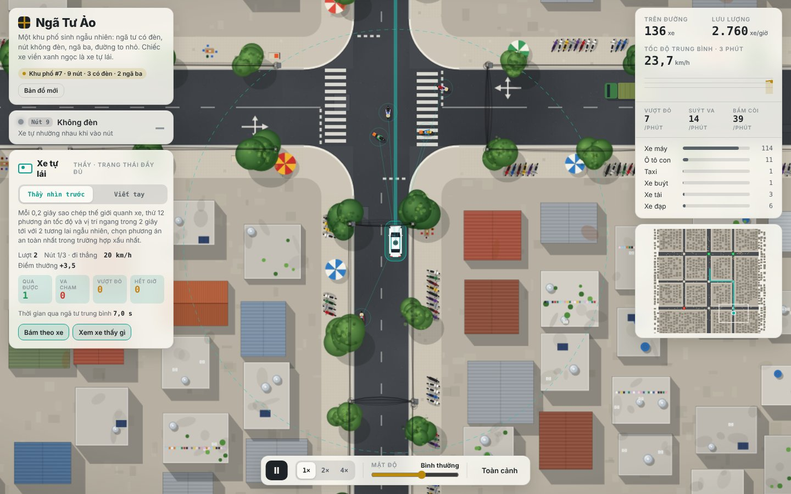
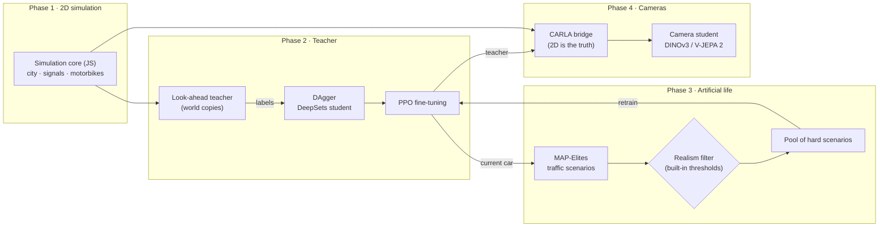
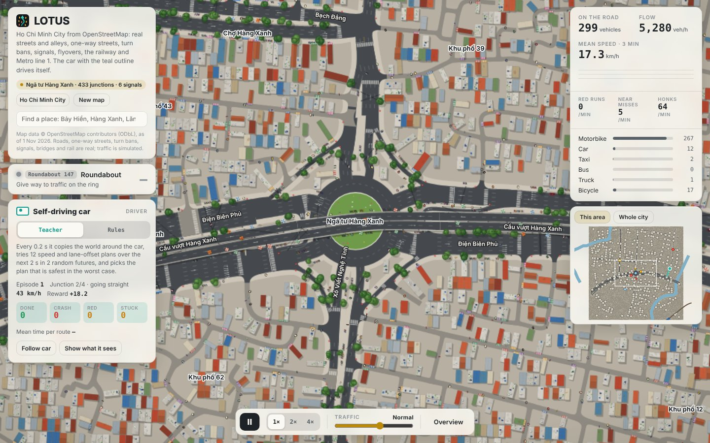

> **LOTUS v6:** multi-step world-model supervision, shield-aware critic, protected teacher replay and validation-gated handover. See [v6 training guide](docs/v6-training.md). Entry: `python train_v6.py --config configs/v6_full.yaml`.

> **LOTUS v5 (P0/P1):** recurrent world model, full-planner curriculum, resumable training and independent evaluation. See [v5 training guide](docs/v5-training.md). Entry: `python rl/v5_train.py --config configs/v5_full.yaml`.

<div align="center">

<picture>
  <source media="(prefers-color-scheme: dark)" srcset="docs/logo/lotus-banner-dark.svg">
  
</picture>

**L**ook-ahead **O**racle **T**eaching in **U**rban **S**warms

**Teaching a self-driving car to move through Vietnamese motorbike traffic with reinforcement learning and artificial life.**

[](#-installation)
[](#-installation)
[](#-installation)
[](#phase-4--camera-student-in-carla)
[](#-run-the-full-pipeline)

**English** · [Tiếng Việt](README.vi.md)



</div>

**LOTUS** (the lotus is Vietnam's national flower) is a complete pipeline from simulation to a camera-only car. It starts with a **procedurally generated 2D Vietnam**: city junctions with countdown timers, 5- and 6-arm junctions, roundabouts, narrow alleys, a market street, a highway with a median, a motorbike lane and U-turn gaps, a level crossing, a village road with buffalo and a flooded stretch, and a mountain pass with hairpins, all on hilly terrain. Hundreds of motorbikes weave through gaps according to their own personalities, and pedestrians cross wherever they like. In that city, a **look-ahead teacher** is distilled into a neural network and fine-tuned with PPO. The motorbike population is then **co-evolved** to find situations that are hard yet still realistic. Finally, the knowledge is transferred to a **student that sees only through cameras**, inside CARLA.

<details open>
<summary><b>Contents</b></summary>

- [✨ Highlights](#-highlights)
- [🧭 Architecture](#-architecture)
- [📦 Installation](#-installation)
- [⚡ 5-minute smoke test](#-5-minute-smoke-test)
- [🚀 Run the full pipeline](#-run-the-full-pipeline)
- [📖 Step-by-step guide](#-step-by-step-guide)
- [⚙️ Configuration](#️-configuration)
- [📊 Results](#-results)
- [🗂️ Repository layout](#️-repository-layout)
- [❓ FAQ](#-faq)
- [🗺️ Roadmap](#️-roadmap)
- [📚 Citation and licence](#-citation-and-licence)

</details>

## ✨ Highlights

| | |
|---|---|
| 🗺️ **Procedural Vietnam** | Eight map types (below), from a single roundabout to a mixed region with all of them. Roads follow the terrain, so there are real slopes, and buildings, market stalls, hills and big vehicles hide what is behind them. Every training scene is a new map, so the car learns to generalise instead of memorising one junction. |
| 🛵 **Motorbikes with personality** | Each road user has its own boldness, patience, rule compliance and preferred speed. Motorbikes weave through gaps, creep over the stop line, run red lights, turn right on red and honk. Phase 3 adds riding against traffic, cutting in, cutting the corner on left turns, sudden braking and jaywalking. Pedestrians, buffalo, tractors, buses and trains share the road too. |
| 🔮 **Look-ahead teacher** | Every 0.2 s the teacher copies the world around the car and tries several options 2.4 s into the future, over several random futures. On the fixed test suite it caused no collisions. |
| 🎓 **Distillation + DAgger + PPO** | A DeepSets network imitates the teacher, is relabelled on the states its own driving reaches, and is then fine-tuned with PPO. |
| 🧬 **Co-evolution with a realism filter** | MAP-Elites finds hard and diverse traffic scenarios. A filter with built-in thresholds rejects "suicidal" motorbike behaviour that no real rider would show. |
| 📷 **Camera student** | Three cameras feed a frozen foundation model (DINOv3 or V-JEPA 2), with auxiliary tasks: signal colour and an occupancy grid. The student learns with DAgger in CARLA. |
| 🌐 **Runs in the browser** | Open `web/lotus.html`: choose the map and who drives, generate a new one, see the 16 road users the network is looking at and what is hidden from it. |

## 🧭 Architecture



**Key principle:** the 2D simulation core is the single source of truth in every phase. CARLA is only a 3D renderer: every step, road users are placed exactly where the 2D core puts them. As a result, the motorbikes evolved in phase 3 behave identically in CARLA, and the teacher always has the exact state it needs to label the student's frames.

## 📦 Installation

**Requirements:** Python 3.9+ and Node.js 18+. Phases 2 and 3 need only CPU (more cores means faster). Phase 4 needs a GPU and CARLA.

```bash
git clone <your-repo> Autopilot-RL && cd Autopilot-RL
pip install -r requirements.txt

# Node.js (pick one)
conda install -c conda-forge nodejs      # or: nvm install 20   ·   macOS: brew install node
node --version                           # >= 18
```

<details>
<summary><b>Extra setup for phase 4 (CARLA)</b></summary>

1. Download the packaged Linux build of CARLA **0.9.15** (or 0.9.13–0.9.16) from the CARLA releases page on GitHub and extract it to `~/CARLA_0.9.15`.
2. Install the Python API for **exactly the same version** as the server:
   ```bash
   pip install carla==0.9.15
   ```
3. Start the server off-screen:
   ```bash
   ~/CARLA_0.9.15/CarlaUE4.sh -RenderOffScreen -carla-rpc-port=2000 &
   ```
4. The **DINOv3** encoder is gated on Hugging Face. Open the `facebook/dinov3-vits16-pretrain-lvd1689m` model page, accept the licence, then run:
   ```bash
   pip install -U "huggingface_hub[cli]" && huggingface-cli login
   ```
   Until access is granted, use `encoder: dinov2` (open) or `vjepa2` in the config.

</details>

## ⚡ 5-minute smoke test

The command below runs the **whole pipeline** (2 → 3 → 4) with tiny settings. Phase 4 uses a dry-run mode with synthetic images, so CARLA is not needed. The only goal is to check that everything is installed correctly:

```bash
python pipeline.py --smoke
```

If the output ends with a `"minutes": ...` line and `rl/runs_smoke/` contains `pipeline_summary.json`, your machine is ready. The numbers in this mode are low because the networks see only a few hundred samples. That is expected.

To watch the simulation, open `web/lotus.html` in a browser. For the Ho Chi Minh City map, serve the folder first: `cd web && python -m http.server`, then open `http://localhost:8000/lotus.html`.

## 🚀 Run the full pipeline

```bash
# (phase 4) start CARLA first:  ~/CARLA_0.9.15/CarlaUE4.sh -RenderOffScreen &
python pipeline.py                                  # 2 -> 3 -> 4 with configs/default.yaml
python pipeline.py --stages 2,3                     # stop before CARLA
python pipeline.py --stages 4 --teacher rl/runs/coevolve/ft_g3/final.json
python pipeline.py --redo 3                         # rerun phase 3 only
```

- **Gates between phases.** A phase only starts once the previous phase meets the thresholds in `configs/default.yaml`, so a weak teacher never feeds the next stage. Use `--force` to skip the gates.
- **Resumable.** Phases that already have results are skipped.
- **Background run on a server:** run it inside `screen`/`tmux` (or `nohup python pipeline.py &`). Everything is also written to `rl/runs/pipeline.log`.

### 📺 Watch training live

When the pipeline starts, it prints a link to the **training monitor**:

```
LOTUS training monitor is running
  Open in a browser:      http://10.0.0.5:8765
  Simulator, live:        http://10.0.0.5:8765/sim
```

Open it from any browser, at any time, while training runs:

- **Dashboard** (`/`): current stage and progress, PPO learning curves (success, crash, red light, timeout, reward), DAgger rounds, driver comparison, the phase-3 scenario archive as a heat map, CPU/RAM/GPU/disk load and the live log. Refreshes every 4 seconds.
- **Simulator** (`/sim`): the city with the car driven by the **newest checkpoint** (PPO writes a snapshot every 10 updates); a button appears when a newer one is ready.

If the server's port is not reachable (firewall, cloud provider), tunnel it from your own computer: `ssh -L 8765:localhost:8765 user@server`, then open `http://localhost:8765`.

| Option | Effect |
|---|---|
| `--port 9000` | another port (the next free one is used if it is busy); `--port 0` turns the monitor off |
| `--bind 127.0.0.1` | only reachable through an SSH tunnel |
| `--exit-when-done` | stop the monitor when the pipeline ends (by default it stays up until Ctrl+C so the results can be viewed) |

The monitor can also run on its own, for example for a training script started by hand or to view finished results: `python monitor/server.py --runs rl/runs --port 8765`. It uses only the Python standard library and never writes into the run folder.

Rough timings on a 32-core server with one GPU:

| Phase | Main work | Time |
|---|---|---|
| 2 | Evaluate 240 scenarios, 4 DAgger rounds × 25k labels, 3M PPO steps | about 2–3 h |
| 3 | 4 generations × 600 scenarios, 1M PPO steps per generation | about 3–4 h |
| 4 | 4 rounds × 40 episodes in CARLA, image encoding, head training | about 3–5 h |

**Resource use.** Phases 2 and 3 load every CPU core except two for hours; each simulation process takes about 150 MB of RAM (about 5–7 GB with 30 workers); the GPU is barely used. Phase 4 needs about 6–8 GB of VRAM for CARLA plus 1–2 GB for the encoder, and 3–5 GB of disk for camera frames. On a shared server, set `workers: 16` in the config and prefix the command with `nice -n 10`.

## 📖 Step-by-step guide

### Phase 1 · 2D simulation

### Ho Chi Minh City (real map, OpenStreetMap)

Training, evaluation and the CARLA export all use **real Ho Chi Minh City** by default. The data come from OpenStreetMap (© OpenStreetMap contributors, ODbL) and include:
- every mapped street and alley with its name, number of lanes, one-way direction and speed limit;
- turn bans, traffic signals, roundabouts, flyovers and tunnels with their levels;
- the North–South railway with its level crossings, and Metro line 1 on its viaduct and in its tunnel;
- rivers and canals, parks, building footprints, bus stops, and the names of junctions and landmarks.

The current build has 450,270 junctions, 536,013 road links, 2,152 signalised junctions, 381 roundabouts, 73 level crossings and 442 turn bans.

The simulation runs on a **window of the city about 1.2 km across**. Roads crossing its edge become entries and exits; dead-end alleys become homes. Each episode starts at a different busy junction somewhere in the city.

In the browser:
- search for a place, accents optional: *Bảy Hiền*, *Hàng Xanh*, *Lăng Cha Cả*, *Ngã sáu Cộng Hòa*…;
- or open the *Whole city* minimap and click anywhere to drive there;
- the page needs to be served over HTTP so it can fetch the map tiles: `cd web && python -m http.server`, then open `http://localhost:8000/lotus.html`;
- `?place=Hàng Xanh` or `?at=x,y` opens a given spot.

Rebuild the data, for example to get newer OpenStreetMap edits:

```bash
# 1. download the Vietnam extract (~330 MB, updated daily) from download.geofabrik.de/asia/vietnam.html
mkdir -p data/osm && curl -L -o data/osm/vietnam-latest.osm.pbf https://download.geofabrik.de/asia/vietnam-latest.osm.pbf
# 2. cut out Ho Chi Minh City (~1 min, needs: pip install osmium)
python data/extract_hcm.py data/osm/vietnam-latest.osm.pbf data/hcm
# 3. build the road network and the tiles in web/hcm/ (~30 s)
node --max-old-space-size=8000 data/build_hcm.js data/hcm web/hcm
```

What is not real:
- **Traffic is simulated.** OpenStreetMap has no traffic counts or signal timings, so signal phases come from the road sizes.
- **Houses are partly generated.** OpenStreetMap has footprints for only some houses; the rest are filled with row houses facing the local street grid.
- **Alleys and signs missing from OpenStreetMap are not invented.** Signs come from the rules: no entry at the far end of one-way streets, no-left / no-right / no-U-turn from turn bans, and the stop and give-way signs that are mapped.
- **Train timetables are estimates.**

The generated maps below are still available (`--presets city,alley`), and are used when the city data are missing.

#### Generated maps

No training. The map generator lives in `web/world.js` and the traffic in `web/sim.js`; both run in the browser and in Node.

| Map (`preset`) | What it contains |
|---|---|
| `region` (default) | One mixed region: a 3×3 town with a diagonal avenue (5- and 6-arm junctions), a roundabout, a market street and a block of alleys; a highway with a median, a motorbike lane, U-turn gaps and bus stops; a mountain pass over a hill; a railway with two level crossings; a village road with buffalo, tractors and a flooded dip. |
| `city` | Town grid with signals, skewed junctions and a market street |
| `alley` | A block of 2–3 m alleys (*hẻm*) opening onto main roads, motorbikes only inside, parked bikes, blind corners |
| `roundabout` | A large roundabout with signalised neighbours |
| `highway` | Divided road with a motorbike lane, U-turn gaps, bus stops |
| `rail` | Level crossings with barriers and trains on a timetable |
| `rural` | Village road: buffalo, tractors, villages, bamboo, a flooded stretch |
| `pass` | Mountain pass with hairpins, steep grades (up to 11%), forest and cliffs |

In the browser, pick the map from the list or open `lotus.html?map=alley`.



```bash
cd web && python build.py          # builds web/lotus.html and embeds any trained networks found in rl/runs/
```

Quick check from Node:

```bash
node -e 'Object.assign(global, require("./web/world.js")); const {Sim}=require("./web/sim.js"); const s=new Sim(cityMap(7,{preset:"region"}),7,0.8); for(let i=0;i<600;i++) s.step(); console.log(s.summary())'
```

### Phase 2 · Full-state teacher

| Step | Command | Output |
|---|---|---|
| 1. Evaluate the baseline | `node rl/eval.js --driver idm --n 240` | success, collision, red-light and stuck rates |
| 2. Evaluate the teacher | `node rl/eval.js --driver planner --n 240 --shard 0 --shards 8` (run 8 processes in parallel) | same |
| 3. Distil (DAgger) | `python rl/distill.py --rounds 4 --decisions 25000 --workers 30` | `rl/runs/teacher_v2/student_r*.pt/.json` |
| 4. PPO fine-tuning | `python rl/finetune.py --init rl/runs/teacher_v2/student_r3.pt --steps 3000000` | `rl/runs/finetune_v2/final.pt/.json` |
| 5. Evaluate the result | `node rl/eval.js --driver rl/runs/finetune_v2/final.json --n 240` | |

Or all at once: `bash rl/run_phase2.sh`.

<details>
<summary><b>The RL problem (observation · action · reward)</b></summary>

- **Observation (299 numbers):** speed, previous command, position in the lane; distance to the stop line, the junction exit and the goal; junction type, signal (or level-crossing barrier) colour and countdown; road grade now and 25 m ahead, sight distance, road width, a yield ahead, flood now and ahead, a pedestrian zone; 10 route waypoints ahead; the 16 nearest road users within 30 m (relative position and velocity, heading, size, true body-to-body gap, time and distance of closest approach, drifting sideways, braking, vulnerable, stationary).
- **Occlusion:** road users hidden behind buildings, stalls, hills or bigger vehicles (a line-of-sight test on the height map) are left out of the observation. The teacher plans with the same view, and adds a phantom motorbike in a blind side street and a stalled vehicle just beyond the sight distance, so it slows down where a careful driver would.
- **Action (every 0.2 s):** target speed (0–50 km/h) and target lateral position in the lane. A low-level controller tracks the speed with acceleration and jerk limits.
- **Reward:**
  - +0.1 per metre of progress, +5 for reaching the goal;
  - collision caused by the car: −10 and the episode ends;
  - running a red light: −6 and the episode ends;
  - an early penalty when time-to-collision drops below 2.5 s;
  - small penalties for driving too close, jerky commands and cornering too fast;
  - stuck for more than 2 minutes: −2.
- **Fault:** in a collision, whoever was moving toward the other faster is at fault. Being hit by someone else ends the episode without a penalty.
- **Teacher:** tries speeds {0, 3, 6, 9, 12 m/s} at the current lateral position, then left/right shifts at the best speed. Each option is rolled out over 3 random futures. Score = 60% worst future + 40% average. About 150 ms per decision on one core.

</details>

### Learned road users and a learned world model (optional)

Two optional stages replace hand-written parts with learned ones. Both run inside the same pipeline and are judged on the same evaluation suite.

**Learned road users** (`rl/npc_train.py`, `web/npc.js`) drive the motorbikes and cars with a neural network instead of the rules.
- The network sees one vehicle's speed, its personality (bold, patient, law-abiding, preferred speed), where it is across the road, the stop line and signal ahead, the turn it is making, the bend ahead and how long it has waited, plus the 10 nearest road users. Every 0.3 s it outputs a target speed and a sideways target.
- It first imitates the rules (behaviour cloning). Then every vehicle in the city is trained together with shared weights (multi-agent PPO): it is rewarded for keeping up with its own preferred speed and penalised for collisions, near misses and, in proportion to how law-abiding it is, for running red lights.
- A pull toward the rule-based decision in the same state keeps the behaviour human-like. It fades but never reaches zero.
- Physics still applies: acceleration limits, the speed a bend allows, emergency braking for what is right in front, and no body ever moves into another.
- Personalities stay inputs, so the phase 3 scenario genomes still shape the population.
- A realism report compares traffic statistics with the rules and with the network.
- Pedestrians, buffalo and trains stay rule-based.

```bash
python pipeline.py --stages npc,2,3,4      # with traffic: learned in configs/default.yaml, every later stage drives among them
python rl/npc_train.py --iters 40 --workers 16   # or on its own; result in rl/runs/npc/npc.json
```

**Learned world model** (`rl/tdmpc2.py`, TD-MPC2 by Hansen, Su & Wang, ICLR 2024, extended) drives by planning in a model it learned itself.
- **The model:** an encoder (DeepSets over the 16 nearest road users it can see), latent dynamics, a reward model, an ensemble of 5 Q functions and a policy prior, plus:
  - **physics heads:** from the latent, the car's speed and where the 6 nearest road users are and how they move; from latent and action, how the car itself moves in 0.2 s. Rolled through the dynamics, this is a prediction of the physical future;
  - **collision head:** the probability of contact within 1, 2 and 3 s;
  - **several futures:** the dynamics proposes 4 hypotheses of the next latent with their odds (multiple-choice learning), so the model can imagine the motorbike cutting in *and* not cutting in;
  - **scenario genome:** dynamics, reward, value and collision are conditioned on the 13 genes of phase 3 (who is on the road and how they ride), so it is a learned simulator of any traffic culture.
- **Risk-aware planning:** every 0.2 s it imagines 256 candidate plans over 6 decisions (1.2 s), each in 3 sampled futures, refines them 5 times (MPPI), and scores a plan by its return minus the predicted contact, halfway between the average and the worst future (CVaR).
- **Evolution inside the world model:** every 50k steps, MAP-Elites proposes 512 scenario genomes and scores them in the model's imagination (how much return the car would get, how often it would touch someone, in that traffic culture). The 12 most promising are checked in the simulation (difficulty for the current car, and the realism filter of phase 3); the hard, realistic ones are kept in a diverse archive and used for 40% of new training maps. Scenarios the car has mastered drop out. The log reports how well imagination predicted reality (`evo/log.json`, `dream_vs_real`).
- **Reward v2 and a defensive teacher:** crashes cost 25, hitting a person 40, being hit 5; on top, defensive driving: slow down near people, keep ~1.2 s to the vehicle ahead, never drive faster than one can stop within sight. Foresight is ~20 s (`gamma` 0.99). The replay buffer starts with 40k decisions of the look-ahead teacher, which prices the same defensive driving. Phases 2 and 3 keep their reward.
- **v3:** a model of ~5.2M parameters (latent 320, hidden 512) trained for 5M steps, with:
  - **trips of random length** (500 m, 1 km, 2 km, 5 km, 15 km, 20 km): the route is extended junction by junction while the map window allows, and continues in a fresh window when it reaches the edge (a truncation for learning, the same trip for the statistics);
  - **a safety shield** on the speed command, from what the car senses: it stops 2.5 m before a red light (or an amber it can still stop for), keeps the room to stop behind the vehicle ahead and behind anyone entering the path (jaywalkers, motorbikes cutting in, predicted from their sideways speed), and slows down near people beside the road. The world model learns on the executed action, and every intervention costs a little reward, so the car learns to drive so that the shield does not have to act;
  - **teacher corrections (DAgger):** the defensive look-ahead teacher labels ~3% of the car's own decisions, and more in risky moments; the policy prior learns from those labels throughout training, not only from the initial demonstrations;
  - **prioritised replay of failures:** a quarter of every batch comes from the seconds before a contact, which are rare but matter most.
- **v4 (current default, run folder `rl/runs/tdmpc2_v4`):** everything in v3, plus:
  - **counterfactual "what if" data:** at ~2% of decisions (6% in risky moments) the simulation is copied around the car and a riskier action (faster, or squeezing sideways) is played out for 1.2 s without the shield. The world model and its collision head learn from what *would* have happened, so they see crashes the shielded car never has (DriveZero / Raw2Drive style). 15% of world-model batches come from these branches;
  - **evolution for learnability** (PLR / ACCEL, AlignADV 2026): a scenario is worth training on when the current car wins it about half the time, so it is scored p(1−p) from 4 real episodes, not by how hard it is. A scenario the look-ahead teacher cannot solve either is dropped as unsolvable (`solv_min`). Imagination is calibrated against the real checks (a logistic fit of imagined difficulty to the real success rate) and picks the candidates expected to be most learnable. The archive keeps the most learnable realistic scenario per cell, and training maps draw them weighted by learnability. Scenarios that became too easy or hopeless leave (`learn_min`). `evo/log.json` reports `mean_learnability`, `unsolvable` and `dream_vs_real`;
  - **optional CaRL reward** (`reward: carl`, Jaeger et al. 2025): 1 point per 100 m of route, scaled by soft penalties (too close, speeding, a shield intervention, a warning); a crash, red light or being hit ends the trip, so the lost rest of the route is the penalty. A simpler reward that scales better with many environments; `v2` stays the default.
- **In the browser:** the **Training** driver on the monitor's `/sim` page replays real training episodes exactly (same seed, same traffic, the actions it chose with its planner), with what it imagined at each decision: its path in each future (orange), where it expected nearby road users to be (violet, dashed pink for the other futures) and its predicted risk of contact. **Prior** is the policy prior alone, swapped in live every 2k steps.

```bash
python pipeline.py --stages wm             # trains it and scores it on the fixed suite, next to the PPO car
python rl/tdmpc2.py --eval rl/runs/tdmpc2_v4/final.pt --eval-n 48   # evaluate a checkpoint with planning
python rl/drive_test.py --run rl/runs/tdmpc2_v4 --km 15            # test drive of a run's best checkpoint
```

**Test drive of the best checkpoint** (`rl/drive_test.py`): the best evaluated checkpoint (`best.pt`, picked by `python rl/tdmpc2.py --best`, completed minus crashed on the fixed suite) drives a 10–20 km journey with its full planner. The journey is a chain of ~1 km stretches, each at a real place (signalised crossroads, roundabouts, Ngã sáu Cộng Hòa, a flyover, a level crossing, residential streets) with a traffic culture to test against (ordinary, rush hour, school gate, night speeders, motorbikes cutting in, wrong-way riders, sudden braking, early left turns, red-light runners) and the hardest scenarios the evolution found. The monitor's `/drive` page replays it exactly, stretch by stretch, with a kilometre bar and the totals (crashes per 100 km, red lights, mean speed, per scenario in `rl/runs/drive/journey.json`).

```bash
python rl/drive_test.py --km 15        # prints the link to /drive when done
```

A GPU is recommended for both: TD-MPC2 updates and plans with batched networks, and the multi-agent PPO trains on hundreds of thousands of decisions per iteration. With `traffic: learned` the simulation itself runs about 3 times slower (every motorbike and car evaluates a small network every 0.3 s), so phases 2 and 3 take longer too.

### Phase 3 · Co-evolution (artificial life)

```bash
python rl/coevolve.py --policy rl/runs/finetune_v2/final.json --init rl/runs/finetune_v2/final.pt --gens 4 --workers 30
```

Each generation has four steps:
1. **MAP-Elites** searches *scenario genomes*: density, motorbike share, personality distributions, and the rates of riding against traffic, cutting in, cutting the corner on left turns and sudden braking, plus pedestrian numbers and the share who jaywalk. The archive is a grid of *density × dominant behaviour*, and each cell keeps its hardest scenario.
2. **Realism filter:** rejects scenarios whose behaviour rates exceed plausible thresholds. The thresholds ship in `calib/priors_vn.json`; **no extra data is needed**.
3. **PPO retraining:** half of the training scenes come from the pool of hard scenarios, the other half are ordinary traffic so the car does not forget.
4. **Re-scoring the whole archive** with the new car. Cells the car has mastered become easy, and the search moves elsewhere.

**Result:** `rl/runs/coevolve/result.json` compares difficulty on a **held-out scenario set** (evolved with a different seed, never trained on) before and after, together with performance in ordinary traffic.

<details>
<summary><b>(Optional) Calibrate the filter from real traffic video</b></summary>

Only needed if you later want thresholds closer to reality. The real trajectories are used **only to set these thresholds**; they do not teach the car to drive.

**1. Get trajectories.** No public Vietnamese trajectory set is ready to download yet; these work out of the box:

| Dataset | Why | Where |
|---|---|---|
| OnSiteVRU (Shanghai) | dense e-bikes, metres, 25 Hz | [Kaggle](https://www.kaggle.com/datasets/zcyan2/mixed-traffic-trajectory-dataset-in-from-shanghai) |
| UAV trajectories, Delhi/Noida | mixed, lane-free, two-wheeler heavy | [Zenodo](https://doi.org/10.5281/zenodo.17745347) |
| HetroD (Taiwan) | right-hand traffic, scooters outnumber cars | [paper](https://arxiv.org/abs/2602.03447) (see its project page for access) |
| UIT-ADrone (Ho Chi Minh City) | Vietnamese drone video, needs your own detector + tracker first | [project page](https://uit-together.github.io/datasets/UIT-ADrone/) |

**2. Convert** to the common CSV (`frame,id,x,y,cls`, metres). Columns are detected automatically and printed; `--*-col` overrides them, `--scale` fixes units, and the printed two-wheeler speed shows at once if the units are wrong:

```bash
python calib/convert_tracks.py --preset onsitevru data/onsitevru/*.csv --out calib/tracks_onsitevru.csv
python calib/convert_tracks.py --preset delhi     data/delhi/*.csv     --out calib/tracks_delhi.csv
python calib/convert_tracks.py --preset hetrod    data/hetrod/*.csv    --out calib/tracks_hetrod.csv
python calib/convert_tracks.py --preset generic my.csv --id-col track --t-col time --x-col px --y-col py --scale 0.05
```

**3. Measure and merge** with the Vietnamese thresholds (each source is measured on its own; for every metric the looser bound wins, so ordinary Vietnamese behaviour is never rejected):

```bash
python calib/fit_from_tracks.py calib/tracks_delhi.csv calib/tracks_onsitevru.csv --merge calib/priors_vn.json --out calib/measured.json
# then in configs/default.yaml: phase3.priors: calib/measured.json, and rerun phase 3: python pipeline.py --stages 3 --redo 3
```

Your own trajectories (fixed camera, drone) work too: any CSV with `frame,id,x,y[,cls]` in metres goes straight into `fit_from_tracks.py` (add `--fps`).

The script measures the same quantities the simulator reports: share of time riding against traffic, cut-ins per vehicle-minute, sudden brakes per two-wheeler-minute, plus speed and acceleration distributions. You can try it first on simulated trajectories: `node calib/export_tracks.js --seconds 120 --out sim.csv`.

> Note: measuring cut-ins and sudden braking from raw trajectories is approximate. Braking in a queue at a red light also counts as sudden braking, so the measured rates tend to be higher than the true ones.

</details>

### Phase 4 · Camera student in CARLA

```bash
~/CARLA_0.9.15/CarlaUE4.sh -RenderOffScreen &          # 1. start CARLA
python carla/phase4.py --teacher rl/runs/coevolve/ft_g3/final.json --rounds 4 --episodes 40 --encoder dinov3
```

What runs inside:

| Step | Standalone command | Description |
|---|---|---|
| Export the map | `node carla/export_xodr.js --seed 7 --preset region --out region7.xodr` | Any map is exported to OpenDRIVE 1.4: roads as chains of cubic pieces (paramPoly3) with an elevation profile and medians, motorbike lanes and sidewalks; inside every junction one connecting road per movement along the exact path of the 2D core. Check it with `python carla/check_xodr.py region7.xodr` (positions, headings and heights must meet). |
| Collect data | `python carla/bridge.py collect --episodes 40 --teacher …` | Three 384×216 cameras at 5 Hz. Each frame stores the teacher's label, the car's speed, the route, the signal colour and the occupancy grid. |
| Encode images | `python carla/student.py encode --data rl/runs/phase4/data --encoder dinov3` | Frozen encoder; features are cached so each frame is encoded once. |
| Train | `python carla/student.py train --data … --out student.pt` | The head learns the action and two auxiliary tasks (signal colour, occupancy grid). |
| DAgger | `bridge.py collect --student student.pt --beta 0.5` | The student drives part of the time while the teacher keeps labelling. |
| Evaluate | `python carla/bridge.py drive --student student.pt --episodes 30` | Closed-loop driving, compared with the teacher on the same scenarios. |

Without CARLA you can still exercise this whole flow with `--dry-run` (synthetic images) and `--encoder tiny`.

## ⚙️ Configuration

All main parameters live in [`configs/default.yaml`](configs/default.yaml):

| Key | Default | Meaning |
|---|---|---|
| `workers` | `auto` | parallel simulation processes (default: CPU cores minus 2) |
| `phase2.decisions` | 25000 | teacher labels per DAgger round |
| `phase2.ft_steps` | 3,000,000 | PPO fine-tuning steps |
| `phase2.gate.min_ok` / `max_crash` | 0.60 / 0.08 | gate to enter phase 3 |
| `phase3.budget` | 600 | scenarios evaluated per generation |
| `phase3.realism` | 0.5 | minimum realism score to enter the archive |
| `phase3.priors` | `calib/priors_vn.json` | realism thresholds (ready to use; optionally replace with values measured from real video) |
| `phase4.encoder` | `dinov3` | `dinov3`, `vjepa2`, `dinov2` or `tiny` |
| `phase4.rounds` / `episodes` | 4 / 40 | DAgger rounds and driving episodes per round |

## 📊 Results

**Phase 2 on real Ho Chi Minh City** (24 windows of the city chosen at random, density 0.5 to 1.05):

| Driver | Success ↑ | At-fault collision ↓ | Red light ↓ | Hit by others | Stuck |
|---|---|---|---|---|---|
| Rule-based driver (IDM) | 62% | 21% | 0% | 8% | 8% |
| **Look-ahead teacher** | **67%** | **8%** | **0%** | 0% | 25% |

The real city is much harder than the generated maps: narrow two-way alleys where the car meets oncoming motorbikes nose to nose, dense queues at six-arm junctions, and pedestrians stepping out between parked bikes. The teacher's failures are mostly getting stuck in such knots; its two collisions were with pedestrians.

**Phase 2 on the generated maps** (all eight map types, density 0.5 to 1.05; 48 episodes for IDM, 24 for the teacher):

| Driver | Success ↑ | At-fault collision ↓ | Red light ↓ | Hit by others | Stuck |
|---|---|---|---|---|---|
| Rule-based driver (IDM) | 69% | 10% | 0% | 2% | 19% |
| **Look-ahead teacher** | **96%** | **0%** | **0%** | 4% | 0% |

The rule-based driver does well on the highway and the mountain pass and struggles in alleys, at the roundabout and in the busy town grid, where it waits for gaps that never come. Results for the DAgger student, PPO fine-tuning, phase 3 and phase 4 will be added after running `python pipeline.py` on a server. `node rl/eval.js --presets alley,pass` evaluates on chosen map types only, and the summary has a `by_preset` breakdown.

## 🗂️ Repository layout

```
Autopilot-RL/
├── pipeline.py              # full pipeline 2 → 3 → 4, with gates
├── configs/default.yaml     # all main parameters
├── monitor/                 # live training monitor: server.py (stdlib web server) + dashboard.html
├── web/                     # Phase 1 + shared code
│   ├── world.js             #   map generator: road network, terrain, buildings, occlusion, eight map presets
│   ├── osm.js               #   Ho Chi Minh City: tiles, windows of the real city, place search
│   ├── npc.js               #   learned road users: observation and network (Node and browser)
│   ├── hcm/                 #   the city as tiles (built by data/build_hcm.js)
│   ├── sim.js               #   traffic: signals, barriers, motorbikes, pedestrians, buffalo, trains, scenario genomes
│   ├── env.js               #   RL environment; SetPolicy/MLPPolicy run networks in the browser and in Node
│   ├── planner.js           #   look-ahead teacher, rule-based driver
│   ├── render.js, ui.js, template.html, build.py   # simulation page
│   └── lotus.html       #   prebuilt page
├── rl/                      # Phases 2 + 3
│   ├── eval.js              #   fixed evaluation suite
│   ├── gen_dagger.js        #   teacher labels for DAgger
│   ├── distill.py           #   distillation into a DeepSets network
│   ├── finetune.py          #   PPO fine-tuning (optionally among evolved scenarios)
│   ├── evolve_eval.js       #   scenario genome evaluation
│   ├── coevolve.py          #   MAP-Elites + realism filter + retraining
│   ├── train.py, sb3_train.py, worker.js   # PPO/SAC from scratch (for comparison)
│   ├── tdmpc2.py, gen_demos.js            # learned world model (TD-MPC2) that drives by planning
│   ├── npc_train.py, gen_npc.js           # learned motorbikes and cars (imitation + multi-agent PPO)
│   └── run_phase2.sh
├── carla/                   # Phase 4
│   ├── export_xodr.js, check_xodr.py       # map → OpenDRIVE, and a checker
│   ├── bridge_worker.js, bridge.py         # bridge: the 2D core is the truth, CARLA renders
│   ├── student.py                          # frozen encoder + head + auxiliary tasks
│   └── phase4.py                           # DAgger loop in CARLA
├── calib/                   # realism thresholds (+ optional calibration from real trajectories)
├── data/                    # extract_hcm.py, build_hcm.js: OpenStreetMap -> Ho Chi Minh City road network
└── docs/images/
```

## ❓ FAQ

<details><summary><b>Do phases 2 and 3 need a GPU?</b></summary>

No. The slow parts are the simulation and the teacher, both running on CPU in Node.js. The networks are small, so a GPU helps very little. The number of CPU cores is what sets the speed.
</details>

<details><summary><b>Is the simulation in the web page "learning"?</b></summary>

No. The page only runs the simulation and shows the drivers: the look-ahead teacher (it replans every step and accumulates no experience), the rule-based driver, and networks that have finished training. Learning happens in `distill.py`, `finetune.py` and `coevolve.py`.
</details>

<details><summary><b>Do I need drone footage or other real data?</b></summary>

No. The realism thresholds ship with the repository (`calib/priors_vn.json`) and the whole pipeline runs without extra data. Calibrating from real video is an optional improvement.
</details>

<details><summary><b><code>node: command not found</code> or Node is too old</b></summary>

Install Node 18 or newer (`conda install -c conda-forge nodejs` or `nvm install 20`), then check with `node --version`.
</details>

<details><summary><b>CARLA version mismatch or connection timeout</b></summary>

The `carla` pip package must match the server version. Start the server first, on port 2000 (change it with `--port`). The first map generation from OpenDRIVE can take about a minute. If GPU memory runs out, reduce the number of cameras or the image size in `carla/bridge.py`.
</details>

<details><summary><b>CARLA shows no traffic lights</b></summary>

The bridge takes the traffic lights CARLA generates for each junction, matches them to the junction and approach in the 2D core, and sets their colour from the 2D core. If your CARLA version does not generate lights from OpenDRIVE, the bridge prints a warning. In that case the student cannot see the signals, and signal information has to be added to its inputs.
</details>

<details><summary><b>DINOv3 does not download</b></summary>

DINOv3 is gated on Hugging Face. Accept the licence on the model page, then run `huggingface-cli login`. Meanwhile, set `phase4.encoder: dinov2`.
</details>

## 🗺️ Roadmap

- [x] Phase 1: procedural 2D city, motorbikes with personality
- [x] Phase 2: look-ahead teacher, DAgger, PPO fine-tuning, fixed evaluation suite
- [x] Phase 3: new behaviours, MAP-Elites, realism filter, co-evolution
- [x] Phase 4: OpenDRIVE export, CARLA bridge, camera student, DAgger
- [ ] Full run on a server and updated results table
- [x] Real map of Ho Chi Minh City from OpenStreetMap (streets, alleys, one-way streets, turn bans, signals, flyovers, rail, metro)
- [ ] Hanoi and other cities with the same pipeline
- [ ] (Optional) Calibrate thresholds from real-video trajectories
- [x] Learned world model (TD-MPC2) and learned road users (imitation + multi-agent RL)
- [ ] Comparison with DreamerV3
- [ ] Pedestrians crossing

## 📚 Citation and licence

```bibtex
@software{lotus_2026,
  title  = {LOTUS: Look-ahead Oracle Teaching in Urban Swarms for self-driving in Vietnamese motorbike traffic},
  author = {Autopilot-RL contributors},
  year   = {2026}
}
```

The repository does not have a licence file yet; the project owner needs to choose one and add a `LICENSE` file. Some third-party components have their own licences: CARLA (MIT code, CC-BY assets), DINOv3 (Meta's DINOv3 licence), V-JEPA 2 (Meta's own licence), and OpenStreetMap data if used later (ODbL).

Ideas this work builds on: Learning by Cheating (Chen et al., 2019), Roach (Zhang et al., 2021), DAgger (Ross et al., 2011), MAP-Elites (Mouret & Clune, 2015), CaRL (2025), PPO (Schulman et al., 2017).
