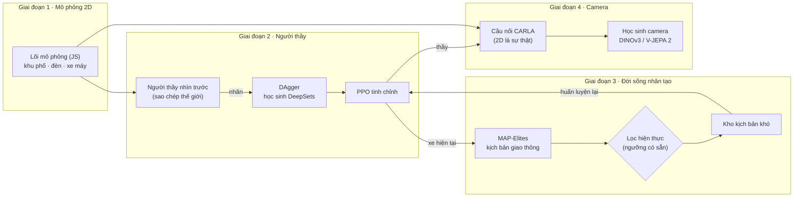

<div align="center">

<picture>
  <source media="(prefers-color-scheme: dark)" srcset="docs/logo/lotus-banner-dark.svg">
  
</picture>

**L**ook-ahead **O**racle **T**eaching in **U**rban **S**warms

**Dạy xe tự lái đi giữa giao thông xe máy kiểu Việt Nam, bằng học tăng cường và đời sống nhân tạo (Artificial Life).**

[](#-cài-đặt)
[](#-cài-đặt)
[](#-cài-đặt)
[](#giai-đoạn-4--học-sinh-nhìn-camera-trong-carla)
[](#-chạy-cả-đường-ống)

[English](README.md) · **Tiếng Việt**


</div>

**LOTUS** (hoa sen, quốc hoa Việt Nam) là một đường ống hoàn chỉnh, từ mô phỏng đến xe nhìn camera. Đầu tiên là một **Việt Nam 2D sinh ngẫu nhiên**: ngã tư có đèn đếm ngược, ngã năm ngã sáu, vòng xoay, hẻm nhỏ, đường chợ, quốc lộ có dải phân cách, làn xe máy và chỗ quay đầu, đường ngang tàu hoả, đường làng có trâu và đoạn ngập, đèo có cua tay áo, tất cả trên địa hình đồi dốc. Hàng trăm xe máy lách khe theo tính cách riêng, người đi bộ băng qua đường ở bất cứ đâu. Trong đó, một **người thầy nhìn trước tương lai** được chưng cất thành mạng nơ-ron rồi tinh chỉnh bằng PPO. Tiếp theo là **đồng tiến hoá** đám xe máy để tìm những tình huống khó mà vẫn giống người thật. Cuối cùng, kiến thức được truyền sang **học sinh chỉ nhìn bằng camera** trong CARLA.

<details open>
<summary><b>Mục lục</b></summary>

- [✨ Điểm nổi bật](#-điểm-nổi-bật)
- [🧭 Kiến trúc](#-kiến-trúc)
- [📦 Cài đặt](#-cài-đặt)
- [⚡ Chạy thử trong 5 phút](#-chạy-thử-trong-5-phút)
- [🚀 Chạy cả đường ống](#-chạy-cả-đường-ống)
- [📖 Hướng dẫn từng giai đoạn](#-hướng-dẫn-từng-giai-đoạn)
- [⚙️ Cấu hình](#️-cấu-hình)
- [📊 Kết quả](#-kết-quả)
- [🗂️ Cấu trúc thư mục](#️-cấu-trúc-thư-mục)
- [❓ Câu hỏi thường gặp](#-câu-hỏi-thường-gặp)
- [🗺️ Lộ trình](#️-lộ-trình)
- [📚 Trích dẫn và giấy phép](#-trích-dẫn-và-giấy-phép)

</details>

## ✨ Điểm nổi bật

| | |
|---|---|
| 🗺️ **Việt Nam sinh ngẫu nhiên** | Tám loại bản đồ (xem bên dưới), từ một vòng xoay đến một vùng hỗn hợp gồm tất cả. Đường bám theo địa hình nên có dốc thật; nhà cửa, sạp chợ, đồi và xe lớn che khuất phía sau. Mỗi cảnh huấn luyện là một bản đồ mới, nên xe học cách tổng quát hoá chứ không học thuộc. |
| 🛵 **Xe máy có tính cách** | Mỗi xe có mức liều lĩnh, kiên nhẫn, tuân thủ luật và tốc độ ưa thích riêng. Xe máy lách khe, bò lên vạch, vượt đỏ, rẽ phải khi đèn đỏ, bấm còi. Giai đoạn 3 thêm đi ngược chiều, tạt đầu, rẽ trái cắt sớm, phanh gấp và băng qua đường ẩu. Trên đường còn có người đi bộ, trâu, máy cày, xe buýt và tàu hoả. |
| 🔮 **Người thầy nhìn trước** | Mỗi 0,2 giây, người thầy sao chép thế giới quanh xe rồi thử nhiều phương án trong 2,4 giây tới, với nhiều tương lai ngẫu nhiên. Trên bộ đề cố định, nó không gây vụ va chạm nào. |
| 🎓 **Chưng cất + DAgger + PPO** | Một mạng DeepSets học theo người thầy. Nó được dạy lại cả trên những tình huống do chính nó lái sai, rồi PPO tinh chỉnh tiếp từ đó. |
| 🧬 **Đồng tiến hoá có lọc hiện thực** | MAP-Elites tìm những kịch bản giao thông khó và đa dạng. Một bộ lọc với ngưỡng có sẵn loại các kiểu xe máy "tự sát", tức là không ai ngoài đời chạy như vậy. |
| 📷 **Học sinh nhìn camera** | Ba camera đưa vào một mô hình nền đóng băng (DINOv3 hoặc V-JEPA 2), kèm các nhiệm vụ phụ: đoán màu đèn và bản đồ chiếm chỗ. Học sinh học theo kiểu DAgger trong CARLA. |
| 🌐 **Xem ngay trên trình duyệt** | Mở `web/lotus.html`: chọn bản đồ và người lái, sinh bản đồ mới, xem 16 xe mà mạng đang quan sát và những gì bị che khuất. |

## 🧭 Kiến trúc



**Nguyên tắc chính:** lõi mô phỏng 2D là nguồn sự thật duy nhất ở mọi giai đoạn. CARLA chỉ là máy vẽ 3D: mỗi bước, các xe được đặt đúng vị trí do lõi 2D tính ra. Nhờ vậy, đám xe máy đã tiến hoá ở giai đoạn 3 chạy y hệt trong CARLA, và người thầy luôn có trạng thái chính xác để chấm bài cho học sinh.

## 📦 Cài đặt

**Yêu cầu:** Python 3.9 trở lên và Node.js 18 trở lên. Giai đoạn 2 và 3 chỉ cần CPU (càng nhiều nhân càng nhanh). Giai đoạn 4 cần GPU và CARLA.

```bash
git clone <repo-của-bạn> Autopilot-RL && cd Autopilot-RL
pip install -r requirements.txt

# Node.js (chọn một cách)
conda install -c conda-forge nodejs      # hoặc: nvm install 20   ·   macOS: brew install node
node --version                           # >= 18
```

<details>
<summary><b>Cài thêm cho giai đoạn 4 (CARLA)</b></summary>

1. Tải CARLA **0.9.15** (hoặc 0.9.13–0.9.16) bản đóng gói cho Linux từ trang phát hành CARLA trên GitHub, giải nén vào `~/CARLA_0.9.15`.
2. Cài Python API **đúng phiên bản** server:
   ```bash
   pip install carla==0.9.15
   ```
3. Chạy server không cửa sổ:
   ```bash
   ~/CARLA_0.9.15/CarlaUE4.sh -RenderOffScreen -carla-rpc-port=2000 &
   ```
4. Bộ mã hoá **DINOv3** nằm trên Hugging Face và có kiểm soát truy cập. Vào trang `facebook/dinov3-vits16-pretrain-lvd1689m`, chấp nhận giấy phép, rồi chạy:
   ```bash
   pip install -U "huggingface_hub[cli]" && huggingface-cli login
   ```
   Nếu chưa có quyền, dùng tạm `encoder: dinov2` (mở) hoặc `vjepa2` trong cấu hình.

</details>

## ⚡ Chạy thử trong 5 phút

Lệnh sau chạy **cả đường ống** (2 → 3 → 4) với số liệu cực nhỏ. Giai đoạn 4 dùng chế độ không cần CARLA, với ảnh tổng hợp. Mục đích chỉ là kiểm tra mọi thứ đã cài đúng:

```bash
python pipeline.py --smoke
```

Nếu thấy dòng `"minutes": ...` ở cuối và thư mục `rl/runs_smoke/` có `pipeline_summary.json` thì máy bạn đã sẵn sàng. Ở chế độ này các con số đều thấp, vì mạng chỉ học vài trăm mẫu. Điều đó là bình thường.

Muốn xem mô phỏng: mở `web/lotus.html` bằng trình duyệt. Với bản đồ TP.HCM, cần phục vụ thư mục trước: `cd web && python -m http.server`, rồi mở `http://localhost:8000/lotus.html`.

## 🚀 Chạy cả đường ống

```bash
# (giai đoạn 4) bật CARLA trước:  ~/CARLA_0.9.15/CarlaUE4.sh -RenderOffScreen &
python pipeline.py                                  # 2 -> 3 -> 4 theo configs/default.yaml
python pipeline.py --stages 2,3                     # dừng trước CARLA
python pipeline.py --stages 4 --teacher rl/runs/coevolve/ft_g3/final.json
python pipeline.py --redo 3                         # chạy lại riêng giai đoạn 3
```

- **Có cửa kiểm tra giữa các giai đoạn.** Giai đoạn sau chỉ chạy khi giai đoạn trước đạt chuẩn trong `configs/default.yaml`, nên một người thầy còn yếu sẽ không làm hỏng các bước sau. Dùng `--force` để bỏ qua cửa kiểm tra.
- **Chạy tiếp được sau khi bị ngắt.** Giai đoạn nào đã có kết quả thì được bỏ qua.
- **Chạy nền trên server:** chạy trong `screen`/`tmux` (hoặc `nohup python pipeline.py &`). Toàn bộ log cũng được ghi vào `rl/runs/pipeline.log`.

### 📺 Xem quá trình học trực tiếp

Khi pipeline bắt đầu, nó in ra link của **trang theo dõi huấn luyện**:

```
LOTUS training monitor is running
  Open in a browser:      http://10.0.0.5:8765
  Simulator, live:        http://10.0.0.5:8765/sim
```

Mở bằng trình duyệt bất cứ lúc nào trong khi train:

- **Dashboard** (`/`): đang ở giai đoạn nào và tiến độ, đường học PPO (qua được, va chạm, vượt đỏ, hết giờ, phần thưởng), các vòng DAgger, bảng so sánh bộ lái, kho tình huống của giai đoạn 3 dạng bản đồ nhiệt, tải CPU/RAM/GPU/ổ đĩa và log trực tiếp. Tự cập nhật mỗi 4 giây.
- **Mô phỏng** (`/sim`): thành phố với xe tự lái chạy bằng **checkpoint mới nhất** (PPO ghi một bản chụp sau mỗi 10 lần cập nhật); khi có bản mới, trang hiện nút để tải lại.

Nếu cổng của server không truy cập được (tường lửa, server cloud), mở đường hầm từ máy của bạn: `ssh -L 8765:localhost:8765 user@server`, rồi vào `http://localhost:8765`.

| Tuỳ chọn | Tác dụng |
|---|---|
| `--port 9000` | đổi cổng (cổng bận thì tự dùng cổng trống kế tiếp); `--port 0` tắt trang theo dõi |
| `--bind 127.0.0.1` | chỉ vào được qua đường hầm SSH |
| `--exit-when-done` | tắt trang theo dõi khi pipeline xong (mặc định vẫn mở đến khi bấm Ctrl+C để xem kết quả) |

Trang theo dõi cũng chạy riêng được, ví dụ cho một script train chạy tay hoặc để xem lại kết quả đã xong: `python monitor/server.py --runs rl/runs --port 8765`. Nó chỉ dùng thư viện chuẩn của Python và không ghi gì vào thư mục runs.

Thời gian tham khảo trên server 32 nhân CPU và 1 GPU:

| Giai đoạn | Việc chính | Thời gian |
|---|---|---|
| 2 | Chấm 240 kịch bản, 4 vòng DAgger × 25k nhãn, PPO 3 triệu bước | khoảng 2–3 giờ |
| 3 | 4 thế hệ × 600 kịch bản, PPO 1 triệu bước mỗi thế hệ | khoảng 3–4 giờ |
| 4 | 4 vòng × 40 lượt trong CARLA, mã hoá ảnh, huấn luyện đầu mạng | khoảng 3–5 giờ |

## 📖 Hướng dẫn từng giai đoạn

### Giai đoạn 1 · Mô phỏng 2D

### TP. Hồ Chí Minh (bản đồ thật, OpenStreetMap)

Mặc định, huấn luyện, đánh giá và xuất sang CARLA đều dùng **TP.HCM thật**. Dữ liệu lấy từ OpenStreetMap (© OpenStreetMap contributors, ODbL), gồm:
- mọi tuyến đường và hẻm đã được vẽ, kèm tên, số làn, chiều đi một chiều và giới hạn tốc độ;
- luật cấm rẽ, đèn tín hiệu, vòng xoay, cầu vượt và hầm chui kèm tầng cao;
- đường sắt Bắc–Nam với các đường ngang, Metro số 1 cả đoạn trên cao lẫn đoạn ngầm;
- sông và kênh, công viên, footprint nhà, trạm xe buýt, tên nút giao và địa danh.

Bản dựng hiện tại có 450.270 nút giao, 536.013 đoạn đường, 2.152 nút có đèn, 381 vòng xoay, 73 đường ngang và 442 luật cấm rẽ.

Mô phỏng chạy trên **một vùng của thành phố, rộng khoảng 1,2 km**. Đường cắt mép vùng thành lối vào ra; hẻm cụt thành "nhà". Mỗi lượt lái bắt đầu ở một nút giao đông khác nhau trong thành phố.

Trên trình duyệt:
- tìm địa điểm, gõ có dấu hay không đều được: *Bảy Hiền*, *Hàng Xanh*, *Lăng Cha Cả*, *Ngã sáu Cộng Hòa*…;
- hoặc mở bản đồ nhỏ *Whole city* rồi bấm vào chỗ muốn lái tới;
- trang phải được phục vụ qua HTTP để tải các ô bản đồ: `cd web && python -m http.server`, rồi mở `http://localhost:8000/lotus.html`;
- `?place=Hàng Xanh` hoặc `?at=x,y` mở đúng một vị trí.

Dựng lại dữ liệu, ví dụ để lấy các chỉnh sửa mới trên OpenStreetMap:

```bash
# 1. tải bản Việt Nam (~330 MB, cập nhật hằng ngày) từ download.geofabrik.de/asia/vietnam.html
mkdir -p data/osm && curl -L -o data/osm/vietnam-latest.osm.pbf https://download.geofabrik.de/asia/vietnam-latest.osm.pbf
# 2. cắt riêng TP.HCM (~1 phút, cần: pip install osmium)
python data/extract_hcm.py data/osm/vietnam-latest.osm.pbf data/hcm
# 3. dựng mạng đường và các ô bản đồ trong web/hcm/ (~30 giây)
node --max-old-space-size=8000 data/build_hcm.js data/hcm web/hcm
```

Những gì không phải thật:
- **Giao thông là mô phỏng.** OpenStreetMap không có lưu lượng xe hay thời gian đèn, nên chu kỳ đèn suy từ cỡ đường.
- **Nhà cửa sinh thêm một phần.** OpenStreetMap chỉ có footprint của một phần nhà; phần còn lại được lấp bằng dãy nhà phố theo hướng đường quanh đó.
- **Hẻm và biển báo không có trên OpenStreetMap thì không bịa ra.** Biển báo suy từ luật: cấm đi ngược chiều ở đầu kia đường một chiều, cấm rẽ trái/phải/quay đầu từ luật cấm rẽ, cùng các biển dừng và nhường đường đã được vẽ.
- **Lịch tàu là ước lượng.**

Các bản đồ sinh ngẫu nhiên bên dưới vẫn dùng được (`--presets city,alley`), và được dùng khi thiếu dữ liệu thành phố.

#### Bản đồ sinh ngẫu nhiên

Không cần huấn luyện. Bộ sinh bản đồ nằm trong `web/world.js`, giao thông trong `web/sim.js`; cả hai chạy được trên trình duyệt lẫn Node.

| Bản đồ (`preset`) | Gồm những gì |
|---|---|
| `region` (mặc định) | Một vùng hỗn hợp: thị trấn 3×3 có đại lộ chéo (ngã năm, ngã sáu), vòng xoay, một phố chợ và một khối hẻm; quốc lộ có dải phân cách, làn xe máy, chỗ quay đầu và trạm xe buýt; một con đèo vượt đồi; đường sắt với hai đường ngang; đường làng có trâu, máy cày và một đoạn trũng ngập nước. |
| `city` | Lưới phố có đèn, nút giao lệch và một phố chợ |
| `alley` | Một khối hẻm 2–3 m thông ra đường lớn, bên trong chỉ có xe máy, xe đỗ, góc khuất |
| `roundabout` | Một vòng xoay lớn và các nút có đèn xung quanh |
| `highway` | Đường có dải phân cách, làn xe máy, chỗ quay đầu, trạm xe buýt |
| `rail` | Đường ngang có rào chắn, tàu chạy theo lịch |
| `rural` | Đường làng: trâu, máy cày, xóm, tre, một đoạn ngập |
| `pass` | Đèo có cua tay áo, dốc tới 11%, rừng và vực |

Trên trình duyệt, chọn bản đồ trong danh sách hoặc mở `lotus.html?map=alley`.


```bash
cd web && python build.py          # tạo web/lotus.html, tự gắn các mạng đã học trong rl/runs/
```

Thử nhanh bằng Node:

```bash
node -e 'Object.assign(global, require("./web/world.js")); const {Sim}=require("./web/sim.js"); const s=new Sim(cityMap(7,{preset:"region"}),7,0.8); for(let i=0;i<600;i++) s.step(); console.log(s.summary())'
```

### Giai đoạn 2 · Người thầy trạng thái đầy đủ

| Bước | Lệnh | Kết quả |
|---|---|---|
| 1. Chấm mốc so sánh | `node rl/eval.js --driver idm --n 240` | tỉ lệ qua được, va chạm, vượt đỏ, kẹt |
| 2. Chấm người thầy | `node rl/eval.js --driver planner --n 240 --shard 0 --shards 8` (chạy 8 tiến trình song song) | như trên |
| 3. Chưng cất (DAgger) | `python rl/distill.py --rounds 4 --decisions 25000 --workers 30` | `rl/runs/teacher_v2/student_r*.pt/.json` |
| 4. PPO tinh chỉnh | `python rl/finetune.py --init rl/runs/teacher_v2/student_r3.pt --steps 3000000` | `rl/runs/finetune_v2/final.pt/.json` |
| 5. Chấm bản cuối | `node rl/eval.js --driver rl/runs/finetune_v2/final.json --n 240` | |

Hoặc gộp bằng một lệnh: `bash rl/run_phase2.sh`.

<details>
<summary><b>Bài toán RL (quan sát · hành động · phần thưởng)</b></summary>

- **Quan sát (299 số):** tốc độ, lệnh trước đó, vị trí trong làn; khoảng cách tới vạch dừng, lối ra và đích; loại nút, màu đèn (hoặc rào chắn đường ngang) và số giây đếm ngược; độ dốc hiện tại và 25 m phía trước, tầm nhìn, bề rộng đường, nút phải nhường phía trước, đang ngập và sắp ngập, khu có người đi bộ; 10 điểm mốc lộ trình phía trước; 16 đối tượng gần nhất trong 30 m (vị trí và vận tốc tương đối, hướng, kích thước, khe hở giữa thân, thời điểm và khoảng cách tiếp cận gần nhất, đang lách ngang, đang phanh, dễ bị tổn thương, đứng yên).
- **Che khuất:** đối tượng bị nhà, sạp chợ, đồi hay xe lớn che (kiểm tra tầm nhìn trên bản đồ độ cao) bị bỏ khỏi quan sát. Người thầy lập kế hoạch với đúng góc nhìn đó, và tự thêm một xe máy "ma" ở hẻm khuất bên hông cùng một xe chết máy ngay sau tầm nhìn, nên nó giảm tốc đúng chỗ một tài xế cẩn thận sẽ giảm.
- **Hành động (mỗi 0,2 s):** tốc độ mong muốn (0–50 km/h) và vị trí ngang trong làn. Một bộ điều khiển cấp thấp bám tốc độ, có giới hạn gia tốc và độ giật.
- **Phần thưởng:**
  - +0,1 cho mỗi mét tiến được, +5 khi tới đích;
  - va chạm do lỗi xe tự lái: −10 và kết thúc lượt;
  - vượt đèn đỏ: −6 và kết thúc lượt;
  - phạt sớm khi thời gian còn lại trước va chạm dưới 2,5 giây;
  - phạt nhẹ khi đi sát xe khác, khi giật cục, khi vào cua quá nhanh;
  - kẹt quá 2 phút: −2.
- **Phân định lỗi:** khi va chạm, bên nào đang lao vào bên kia nhanh hơn thì bên đó có lỗi. Bị xe khác tông vào thì lượt kết thúc nhưng không bị phạt.
- **Người thầy:** thử tốc độ {0, 3, 6, 9, 12 m/s} khi giữ nguyên vị trí ngang, rồi thử dịch trái/phải ở tốc độ tốt nhất. Mỗi phương án chạy thử 3 tương lai ngẫu nhiên. Điểm = 60% tương lai xấu nhất + 40% trung bình. Thời gian khoảng 150 ms cho mỗi quyết định trên một nhân.

</details>

### Xe cộ học được và mô hình thế giới học được (tuỳ chọn)

Hai giai đoạn tuỳ chọn thay những phần viết tay bằng phần học được. Cả hai chạy trong cùng đường ống và được chấm trên cùng bộ đề.

**Xe cộ học được** (`rl/npc_train.py`, `web/npc.js`): xe máy và ô tô do mạng nơ-ron lái thay cho bộ luật.
- Mạng nhìn thấy, cho từng xe: tốc độ, tính cách (liều lĩnh, kiên nhẫn, tuân thủ luật, tốc độ ưa thích), vị trí ngang trên đường, vạch dừng và đèn phía trước, hướng rẽ, khúc cua phía trước, đã chờ bao lâu, cùng 10 đối tượng gần nhất. Cứ 0,3 giây mạng chọn một tốc độ mục tiêu và một vị trí ngang mục tiêu.
- Đầu tiên mạng bắt chước bộ luật. Sau đó mọi xe trong thành phố cùng học chung một bộ trọng số (PPO nhiều tác tử): được thưởng khi theo kịp tốc độ ưa thích của chính mình, bị phạt khi va chạm, suýt va chạm, và khi vượt đèn đỏ (phạt nặng hơn với người vốn tuân thủ luật).
- Một lực kéo về quyết định của bộ luật trong cùng tình huống giữ cho hành vi giống người. Lực này giảm dần nhưng không bao giờ về 0.
- Vật lý vẫn được giữ: giới hạn gia tốc, tốc độ tối đa qua cua, phanh khẩn cấp với vật ngay phía trước, và không thân xe nào lấn vào thân xe khác.
- Tính cách vẫn là đầu vào, nên bộ gen kịch bản của giai đoạn 3 vẫn điều khiển được đám đông.
- Một báo cáo hiện thực so sánh thống kê giao thông giữa bộ luật và mạng.
- Người đi bộ, trâu và tàu vẫn chạy theo luật.

```bash
python pipeline.py --stages npc,2,3,4      # đặt traffic: learned trong configs/default.yaml để các giai đoạn sau chạy giữa xe học được
python rl/npc_train.py --iters 40 --workers 16   # hoặc chạy riêng; kết quả ở rl/runs/npc/npc.json
```

**Mô hình thế giới học được** (`rl/tdmpc2.py`, TD-MPC2 của Hansen, Su & Wang, ICLR 2024, có mở rộng): xe lái bằng cách lập kế hoạch trong mô hình do chính nó học.
- **Mô hình:** bộ mã hoá (DeepSets trên 16 đối tượng gần nhất nhìn thấy được), động lực học trong không gian ẩn, mô hình phần thưởng, 5 hàm Q và chính sách gợi ý, cộng thêm:
  - **đầu vật lý:** từ trạng thái ẩn đoán tốc độ của xe và vị trí, chuyển động của 6 đối tượng gần nhất; từ trạng thái ẩn và hành động đoán xe tự di chuyển thế nào trong 0,2 giây. Lăn qua động lực học, đây là dự đoán tương lai vật lý;
  - **đầu va chạm:** xác suất va chạm trong 1, 2 và 3 giây;
  - **nhiều tương lai:** động lực học đưa ra 4 giả thuyết cho bước tiếp theo kèm xác suất (multiple-choice learning), nên mô hình tưởng tượng được cả khi xe máy tạt đầu lẫn khi không;
  - **genome kịch bản:** động lực học, phần thưởng, giá trị và va chạm có điều kiện theo 13 gen của giai đoạn 3 (ai ở trên đường, chạy kiểu gì), nên mô hình là một bộ mô phỏng học được cho mọi văn hoá giao thông.
- **Lập kế hoạch tính đến rủi ro:** mỗi 0,2 giây, nó tưởng tượng 256 phương án dài 6 bước (1,2 giây), mỗi phương án trong 3 tương lai bốc ngẫu nhiên, tinh chỉnh 5 lần (MPPI), và chấm điểm bằng phần thưởng trừ xác suất va chạm dự đoán, lấy giữa trung bình và tương lai xấu nhất (CVaR).
- **Tiến hoá bên trong world model:** cứ 50k bước, MAP-Elites đề xuất 512 genome kịch bản và chấm chúng trong "giấc mơ" của mô hình (xe sẽ được bao nhiêu điểm, va chạm thường đến mức nào với văn hoá giao thông đó). 12 genome hứa hẹn nhất được kiểm tra trong mô phỏng thật (độ khó với xe hiện tại, và bộ lọc độ thật của giai đoạn 3). Những kịch bản khó mà thật được giữ trong một kho đa dạng và dùng cho 40% bản đồ train mới; kịch bản xe đã thắng thì bị loại. Log ghi mức độ "giấc mơ" đoán đúng thực tế (`evo/log.json`, `dream_vs_real`).
- **Thưởng v2 và người thầy phòng thủ:** đâm xe −25, đâm người −40, bị đâm −5; thêm lái phòng thủ: chậm lại gần người đi bộ, giữ khoảng 1,2 giây với xe trước, không chạy nhanh hơn mức dừng kịp trong tầm nhìn. Tầm nhìn xa khoảng 20 giây (`gamma` 0,99). Bộ nhớ khởi đầu bằng 40k quyết định của người thầy nhìn trước, cũng tính chi phí lái phòng thủ y như vậy. Giai đoạn 2 và 3 giữ nguyên phần thưởng cũ.
- **Trên trình duyệt:** nút **Training** ở trang `/sim` của monitor phát lại chính xác các episode train thật (cùng seed, cùng giao thông, đúng các hành động planner đã chọn), kèm những gì nó tưởng tượng ở mỗi quyết định: đường đi trong từng tương lai (cam), nơi nó đoán xe quanh sẽ ở (tím, nét đứt hồng cho các tương lai khác) và rủi ro va chạm dự đoán. **Prior** là riêng chính sách gợi ý, được thay mới trực tiếp mỗi 2k bước.

```bash
python pipeline.py --stages wm             # huấn luyện và chấm trên bộ đề cố định, đặt cạnh xe PPO
python rl/tdmpc2.py --eval rl/runs/tdmpc2/final.pt --eval-n 48   # đánh giá một checkpoint có lập kế hoạch
```

**Lái thử checkpoint tốt nhất** (`rl/drive_test.py`): checkpoint đánh giá tốt nhất (`best.pt`, chọn bằng `python rl/tdmpc2.py --best`, theo tỉ lệ đi tới nơi trừ tỉ lệ đâm trên bộ đề cố định) lái một chuyến 10–20 km với bộ lập kế hoạch đầy đủ. Chuyến gồm các chặng khoảng 1 km, mỗi chặng ở một địa điểm thật (ngã tư có đèn, vòng xoay, Ngã sáu Cộng Hòa, cầu vượt, chỗ cắt đường sắt, khu dân cư) với một kiểu giao thông để thử thách (bình thường, giờ cao điểm, cổng trường, đêm chạy ẩu, xe máy tạt đầu, đi ngược chiều, phanh gấp, rẽ trái sớm, vượt đèn đỏ) và các kịch bản khó nhất mà tiến hoá tìm ra. Trang `/drive` của monitor phát lại chính xác từng chặng, có thanh km và số liệu tổng (đâm trên 100 km, vượt đèn đỏ, tốc độ trung bình, theo từng kịch bản trong `rl/runs/drive/journey.json`).

```bash
python rl/drive_test.py --km 15        # chạy xong in ra link /drive
```

Nên có GPU cho cả hai: TD-MPC2 cập nhật và lập kế hoạch bằng mạng chạy theo lô, còn PPO nhiều tác tử học trên hàng trăm nghìn quyết định mỗi vòng. Với `traffic: learned`, bản thân mô phỏng chạy chậm hơn khoảng 3 lần (mỗi xe máy và ô tô chạy một mạng nhỏ mỗi 0,3 giây), nên giai đoạn 2 và 3 cũng lâu hơn.

### Giai đoạn 3 · Đồng tiến hoá (Artificial Life)

```bash
python rl/coevolve.py --policy rl/runs/finetune_v2/final.json --init rl/runs/finetune_v2/final.pt --gens 4 --workers 30
```

Mỗi thế hệ gồm bốn bước:
1. **MAP-Elites** tìm các *bộ gen kịch bản*: mật độ, tỉ lệ xe máy, phân bố tính cách, tỉ lệ đi ngược chiều, tạt đầu, rẽ trái cắt sớm, phanh gấp, cùng số người đi bộ và tỉ lệ băng qua đường ẩu. Kho được chia thành lưới *mật độ × hành vi nổi bật*, và mỗi ô giữ kịch bản khó nhất của nó.
2. **Lọc hiện thực:** loại kịch bản có tỉ lệ hành vi vượt ngưỡng hợp lý. Ngưỡng nằm sẵn trong `calib/priors_vn.json`, **không cần thu thêm dữ liệu nào**.
3. **PPO huấn luyện lại** xe tự lái: một nửa số cảnh lấy từ kho kịch bản khó, một nửa là giao thông thường để xe không quên.
4. **Chấm lại cả kho** với xe mới. Ô nào xe đã thắng được sẽ trở nên dễ, và cuộc tìm kiếm chuyển sang chỗ khác.

**Kết quả:** `rl/runs/coevolve/result.json` so sánh độ khó trên **bộ kịch bản giữ riêng** (tiến hoá với hạt giống khác, chưa từng dùng để huấn luyện) trước và sau, cùng hiệu năng trên giao thông thường.

<details>
<summary><b>(Tuỳ chọn, không bắt buộc) Hiệu chỉnh bộ lọc từ video giao thông thật</b></summary>

Chỉ cần nếu sau này bạn muốn ngưỡng sát thực tế hơn. Quỹ đạo thật **chỉ dùng để đặt các ngưỡng này**, không dùng để dạy xe lái.

**1. Lấy quỹ đạo.** Hiện chưa có bộ quỹ đạo Việt Nam nào tải về dùng ngay được; các bộ sau dùng được luôn:

| Bộ dữ liệu | Vì sao | Ở đâu |
|---|---|---|
| OnSiteVRU (Thượng Hải) | xe đạp điện dày đặc, toạ độ mét, 25 Hz | [Kaggle](https://www.kaggle.com/datasets/zcyan2/mixed-traffic-trajectory-dataset-in-from-shanghai) |
| Quỹ đạo drone Delhi/Noida | hỗn hợp, không theo làn, nhiều xe hai bánh | [Zenodo](https://doi.org/10.5281/zenodo.17745347) |
| HetroD (Đài Loan) | đi bên phải, xe tay ga nhiều hơn ô tô | [bài báo](https://arxiv.org/abs/2602.03447) (xem trang dự án để biết cách tải) |
| UIT-ADrone (TP.HCM) | video drone Việt Nam, cần tự dò và bám xe trước | [trang dự án](https://uit-together.github.io/datasets/UIT-ADrone/) |

**2. Chuyển đổi** sang CSV chung (`frame,id,x,y,cls`, đơn vị mét). Script tự nhận cột và in ra; `--*-col` để chỉ định lại, `--scale` để đổi đơn vị, và tốc độ xe hai bánh in ra cho biết ngay nếu sai đơn vị:

```bash
python calib/convert_tracks.py --preset onsitevru data/onsitevru/*.csv --out calib/tracks_onsitevru.csv
python calib/convert_tracks.py --preset delhi     data/delhi/*.csv     --out calib/tracks_delhi.csv
python calib/convert_tracks.py --preset hetrod    data/hetrod/*.csv    --out calib/tracks_hetrod.csv
python calib/convert_tracks.py --preset generic my.csv --id-col track --t-col time --x-col px --y-col py --scale 0.05
```

**3. Đo và gộp** với ngưỡng Việt Nam (mỗi nguồn đo riêng; ở mỗi chỉ số giữ ngưỡng rộng hơn, để không loại nhầm hành vi bình thường ở Việt Nam):

```bash
python calib/fit_from_tracks.py calib/tracks_delhi.csv calib/tracks_onsitevru.csv --merge calib/priors_vn.json --out calib/measured.json
# rồi trong configs/default.yaml: phase3.priors: calib/measured.json, và chạy lại giai đoạn 3: python pipeline.py --stages 3 --redo 3
```

Quỹ đạo tự thu (camera cố định, drone) cũng dùng được: mọi CSV có `frame,id,x,y[,cls]` tính bằng mét đưa thẳng vào `fit_from_tracks.py` (thêm `--fps`).

Script đo các chỉ số theo định nghĩa giống mô phỏng: tỉ lệ thời gian đi ngược chiều, số lần tạt đầu trên mỗi xe-phút, số lần phanh gấp trên mỗi xe máy-phút, kèm phân bố tốc độ và gia tốc. Có thể thử trước bằng quỹ đạo mô phỏng: `node calib/export_tracks.js --seconds 120 --out sim.csv`.

> Lưu ý: cách đo tạt đầu và phanh gấp từ quỹ đạo thô mới là gần đúng. Phanh trong hàng chờ đèn cũng bị tính là phanh gấp, nên số đo có xu hướng cao hơn thực tế.

</details>

### Giai đoạn 4 · Học sinh nhìn camera trong CARLA

```bash
~/CARLA_0.9.15/CarlaUE4.sh -RenderOffScreen &          # 1. bật CARLA
python carla/phase4.py --teacher rl/runs/coevolve/ft_g3/final.json --rounds 4 --episodes 40 --encoder dinov3
```

Đường ống bên trong:

| Bước | Lệnh riêng lẻ | Mô tả |
|---|---|---|
| Xuất bản đồ | `node carla/export_xodr.js --seed 7 --preset region --out region7.xodr` | Bản đồ bất kỳ được xuất sang OpenDRIVE 1.4: đường là chuỗi đoạn bậc ba (paramPoly3) có cao độ, dải phân cách, làn xe máy và vỉa hè; trong mỗi nút, mỗi hướng đi là một đường nối bám đúng quỹ đạo của lõi 2D. Kiểm tra bằng `python carla/check_xodr.py region7.xodr` (vị trí, hướng và cao độ phải khớp). |
| Thu dữ liệu | `python carla/bridge.py collect --episodes 40 --teacher …` | 3 camera 384×216 ở 5 Hz. Mỗi khung có nhãn của thầy, tốc độ xe, lộ trình, màu đèn và bản đồ chiếm chỗ. |
| Mã hoá ảnh | `python carla/student.py encode --data rl/runs/phase4/data --encoder dinov3` | Bộ mã hoá đóng băng; đặc trưng được lưu cache nên chỉ mã hoá một lần. |
| Huấn luyện | `python carla/student.py train --data … --out student.pt` | Đầu mạng học hành động và hai nhiệm vụ phụ (màu đèn, bản đồ chiếm chỗ). |
| DAgger | `bridge.py collect --student student.pt --beta 0.5` | Học sinh tự lái một phần thời gian, thầy tiếp tục chấm. |
| Đánh giá | `python carla/bridge.py drive --student student.pt --episodes 30` | Lái vòng kín, so với thầy trên cùng kịch bản. |

Không có CARLA vẫn kiểm tra được toàn bộ luồng này bằng `--dry-run` (ảnh tổng hợp) và `--encoder tiny`.

## ⚙️ Cấu hình

Mọi tham số chính nằm trong [`configs/default.yaml`](configs/default.yaml):

| Khoá | Mặc định | Ý nghĩa |
|---|---|---|
| `workers` | `auto` | số tiến trình mô phỏng song song (mặc định: số nhân CPU trừ 2) |
| `phase2.decisions` | 25000 | số nhãn của người thầy mỗi vòng DAgger |
| `phase2.ft_steps` | 3 000 000 | số bước PPO tinh chỉnh |
| `phase2.gate.min_ok` / `max_crash` | 0,60 / 0,08 | cửa kiểm tra để sang giai đoạn 3 |
| `phase3.budget` | 600 | số kịch bản được chấm mỗi thế hệ |
| `phase3.realism` | 0,5 | điểm hiện thực tối thiểu để vào kho |
| `phase3.priors` | `calib/priors_vn.json` | ngưỡng hiện thực (dùng sẵn được; tuỳ chọn thay bằng số đo từ video thật) |
| `phase4.encoder` | `dinov3` | `dinov3`, `vjepa2`, `dinov2` hoặc `tiny` |
| `phase4.rounds` / `episodes` | 4 / 40 | số vòng DAgger và số lượt lái mỗi vòng |

## 📊 Kết quả

**Giai đoạn 2 trên TP.HCM thật** (24 vùng chọn ngẫu nhiên trong thành phố, mật độ 0,5 đến 1,05):

| Người lái | Qua được ↑ | Va chạm do lỗi mình ↓ | Vượt đỏ ↓ | Bị xe khác tông | Kẹt |
|---|---|---|---|---|---|
| Bộ lái viết tay (IDM) | 62% | 21% | 0% | 8% | 8% |
| **Người thầy nhìn trước** | **67%** | **8%** | **0%** | 0% | 25% |

Thành phố thật khó hơn nhiều so với bản đồ sinh: hẻm hai chiều hẹp nơi xe gặp xe máy ngược chiều đối đầu, hàng xe dài ở ngã sáu, người đi bộ bước ra giữa hàng xe máy đỗ. Thất bại của người thầy chủ yếu là kẹt trong những nút thắt như vậy; hai lần va chạm đều với người đi bộ.

**Giai đoạn 2 trên bản đồ sinh** (cả tám loại bản đồ, mật độ 0,5 đến 1,05; 48 lượt cho IDM, 24 lượt cho người thầy):

| Người lái | Qua được ↑ | Va chạm do lỗi mình ↓ | Vượt đỏ ↓ | Bị xe khác tông | Kẹt |
|---|---|---|---|---|---|
| Bộ lái viết tay (IDM) | 69% | 10% | 0% | 2% | 19% |
| **Người thầy nhìn trước** | **96%** | **0%** | **0%** | 4% | 0% |

Bộ lái viết tay chạy tốt trên quốc lộ và đèo, nhưng vất vả trong hẻm, ở vòng xoay và trong lưới phố đông, nơi nó cứ chờ một khe hở không bao giờ tới. Kết quả của học sinh DAgger, PPO tinh chỉnh, giai đoạn 3 và giai đoạn 4 sẽ được thêm vào sau khi chạy `python pipeline.py` trên server. `node rl/eval.js --presets alley,pass` chỉ đánh giá trên các loại bản đồ đã chọn, và bản tóm tắt có mục `by_preset` theo từng loại.

## 🗂️ Cấu trúc thư mục

```
Autopilot-RL/
├── pipeline.py              # chạy cả đường ống 2 → 3 → 4, có cửa kiểm tra
├── monitor/                 # trang theo dõi huấn luyện: server.py (web server thư viện chuẩn) + dashboard.html
├── configs/default.yaml     # mọi tham số chính
├── web/                     # Giai đoạn 1 + phần dùng chung
│   ├── world.js             #   bộ sinh bản đồ: mạng đường, địa hình, nhà cửa, che khuất, tám loại bản đồ
│   ├── osm.js               #   TP.HCM: các ô bản đồ, cắt vùng của thành phố thật, tìm địa điểm
│   ├── npc.js               #   xe cộ học được: quan sát và mạng nơ-ron (Node và trình duyệt)
│   ├── hcm/                 #   thành phố dạng ô (dựng bởi data/build_hcm.js)
│   ├── sim.js               #   giao thông: đèn, rào chắn, xe máy, người đi bộ, trâu, tàu, bộ gen kịch bản
│   ├── env.js               #   môi trường RL; SetPolicy/MLPPolicy chạy mạng trên trình duyệt và Node
│   ├── planner.js           #   người thầy nhìn trước, bộ lái viết tay
│   ├── render.js, ui.js, template.html, build.py   # trang mô phỏng
│   └── lotus.html       #   trang đã dựng sẵn
├── rl/                      # Giai đoạn 2 + 3
│   ├── eval.js              #   bộ đề cố định
│   ├── gen_dagger.js        #   sinh nhãn của người thầy (DAgger)
│   ├── distill.py           #   chưng cất vào mạng DeepSets
│   ├── finetune.py          #   PPO tinh chỉnh (có tuỳ chọn kho kịch bản tiến hoá)
│   ├── evolve_eval.js       #   chấm bộ gen kịch bản
│   ├── coevolve.py          #   MAP-Elites + lọc hiện thực + huấn luyện lại
│   ├── train.py, sb3_train.py, worker.js   # PPO/SAC học từ đầu (để so sánh)
│   ├── tdmpc2.py, gen_demos.js            # mô hình thế giới học được (TD-MPC2), lái bằng lập kế hoạch
│   ├── npc_train.py, gen_npc.js           # xe máy và ô tô học được (bắt chước + PPO nhiều tác tử)
│   └── run_phase2.sh
├── carla/                   # Giai đoạn 4
│   ├── export_xodr.js, check_xodr.py       # bản đồ → OpenDRIVE, và kiểm tra
│   ├── bridge_worker.js, bridge.py         # cầu nối: lõi 2D là sự thật, CARLA vẽ
│   ├── student.py                          # bộ mã hoá đóng băng + đầu mạng + nhiệm vụ phụ
│   └── phase4.py                           # vòng DAgger trong CARLA
├── calib/                   # ngưỡng hiện thực + hiệu chỉnh từ quỹ đạo thật
├── data/                    # extract_hcm.py, build_hcm.js: OpenStreetMap -> mạng đường TP.HCM
└── docs/images/
```

## ❓ Câu hỏi thường gặp

<details><summary><b>Có cần GPU cho giai đoạn 2 và 3 không?</b></summary>

Không. Phần chậm là mô phỏng và người thầy, đều chạy trên CPU bằng Node.js. Mạng nơ-ron nhỏ nên GPU giúp rất ít. Số nhân CPU mới quyết định tốc độ.
</details>

<details><summary><b>Mô phỏng trên trang web có đang "học" không?</b></summary>

Không. Trang chỉ chạy mô phỏng và cho xem người lái: người thầy nhìn trước (lập kế hoạch lại ở mỗi bước, không tích luỹ kinh nghiệm), bộ lái viết tay, và các mạng đã học xong. Việc học diễn ra trong `distill.py`, `finetune.py` và `coevolve.py`.
</details>

<details><summary><b>Lỗi <code>node: command not found</code> hoặc Node quá cũ</b></summary>

Cài Node 18 trở lên (`conda install -c conda-forge nodejs` hoặc `nvm install 20`), rồi kiểm tra bằng `node --version`.
</details>

<details><summary><b>CARLA báo lỗi phiên bản hoặc kết nối quá thời gian</b></summary>

Gói `carla` cài bằng pip phải trùng phiên bản với server. Server cần bật trước, ở cổng 2000 (`--port` để đổi). Lần đầu tạo bản đồ từ OpenDRIVE có thể mất khoảng 1 phút. Nếu máy thiếu bộ nhớ GPU, giảm số camera hoặc kích thước ảnh trong `carla/bridge.py`.
</details>

<details><summary><b>CARLA không hiện đèn tín hiệu</b></summary>

Cầu nối lấy các cột đèn CARLA tự sinh cho từng nút giao, khớp chúng với nút và hướng của lõi 2D, rồi đặt màu theo lõi 2D. Nếu phiên bản CARLA của bạn không tự sinh đèn từ OpenDRIVE, cầu nối sẽ in cảnh báo. Khi đó học sinh không nhìn thấy đèn, và cần bổ sung thông tin đèn vào đầu vào.
</details>

<details><summary><b>Không tải được DINOv3</b></summary>

DINOv3 có kiểm soát truy cập trên Hugging Face. Hãy chấp nhận giấy phép trên trang mô hình rồi chạy `huggingface-cli login`. Trong lúc chờ, đặt `phase4.encoder: dinov2`.
</details>

## 🗺️ Lộ trình

- [x] Giai đoạn 1: khu phố 2D sinh ngẫu nhiên, xe máy có tính cách
- [x] Giai đoạn 2: người thầy nhìn trước, DAgger, PPO tinh chỉnh, bộ đề cố định
- [x] Giai đoạn 3: hành vi mới, MAP-Elites, lọc hiện thực, đồng tiến hoá
- [x] Giai đoạn 4: OpenDRIVE, cầu nối CARLA, học sinh camera, DAgger
- [ ] Chạy đầy đủ trên server và cập nhật bảng kết quả
- [x] Bản đồ thật TP.HCM từ OpenStreetMap (đường, hẻm, một chiều, cấm rẽ, đèn, cầu vượt, đường sắt, metro)
- [ ] Hà Nội và các thành phố khác với cùng quy trình
- [ ] (Tuỳ chọn) Hiệu chỉnh ngưỡng bằng quỹ đạo từ video thật
- [x] Mô hình thế giới học được (TD-MPC2) và xe cộ học được (bắt chước + RL nhiều tác tử)
- [ ] So sánh với DreamerV3
- [ ] Người đi bộ qua đường

## 📚 Trích dẫn và giấy phép

```bibtex
@software{lotus_2026,
  title  = {LOTUS: Look-ahead Oracle Teaching in Urban Swarms for self-driving in Vietnamese motorbike traffic},
  author = {Autopilot-RL contributors},
  year   = {2026}
}
```

Repo chưa có tệp giấy phép, nên chủ dự án cần chọn và thêm tệp `LICENSE`. Một số thành phần bên thứ ba có giấy phép riêng: CARLA (mã nguồn MIT, tài sản đồ hoạ CC-BY), DINOv3 (giấy phép DINOv3 của Meta), V-JEPA 2 (giấy phép riêng của Meta), dữ liệu OpenStreetMap nếu dùng sau này (ODbL).

Ý tưởng tham khảo: Learning by Cheating (Chen và cộng sự, 2019), Roach (Zhang và cộng sự, 2021), DAgger (Ross và cộng sự, 2011), MAP-Elites (Mouret và Clune, 2015), CaRL (2025), PPO (Schulman và cộng sự, 2017).
