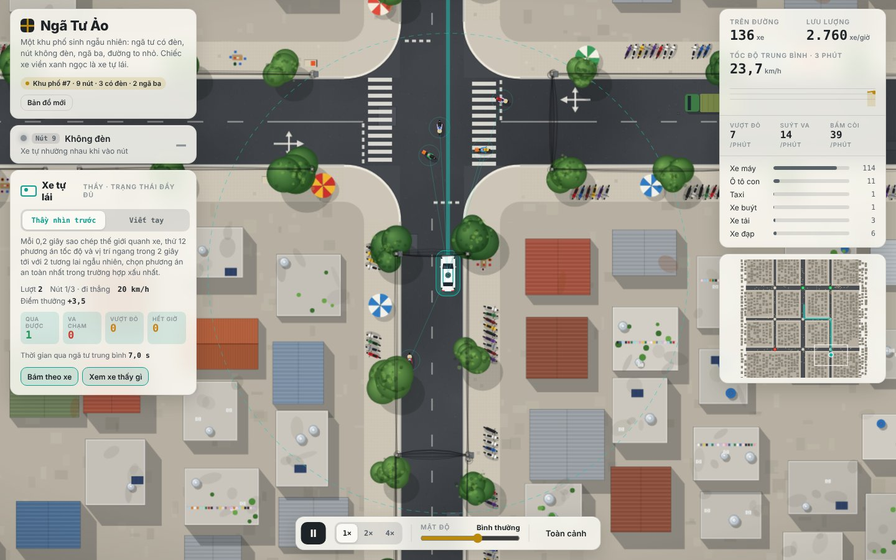
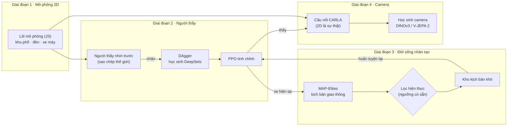
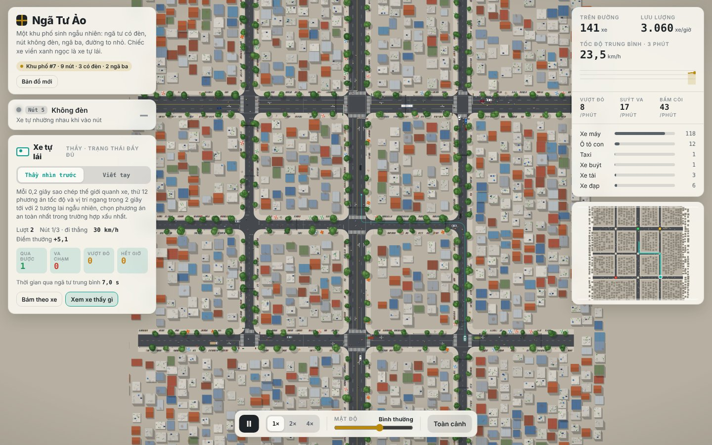

<div align="center">

# 🪷 LOTUS · Autopilot-RL

**L**ook-ahead **O**racle **T**eaching in **U**rban **S**warms

**Dạy xe tự lái đi giữa giao thông xe máy kiểu Việt Nam, bằng học tăng cường và đời sống nhân tạo (Artificial Life).**

[](#-cài-đặt)
[](#-cài-đặt)
[](#-cài-đặt)
[](#giai-đoạn-4--học-sinh-nhìn-camera-trong-carla)
[](#-chạy-cả-đường-ống)

[English](README.md) · **Tiếng Việt**



</div>

**LOTUS** (hoa sen, quốc hoa Việt Nam) là một đường ống hoàn chỉnh, từ mô phỏng đến xe nhìn camera. Đầu tiên là một **khu phố 2D sinh ngẫu nhiên**: ngã tư có đèn đếm ngược, nút không đèn, ngã ba, và hàng trăm xe máy lách khe theo tính cách riêng. Trong đó, một **người thầy nhìn trước tương lai** được chưng cất thành mạng nơ-ron rồi tinh chỉnh bằng PPO. Tiếp theo là **đồng tiến hoá** đám xe máy để tìm những tình huống khó mà vẫn giống người thật. Cuối cùng, kiến thức được truyền sang **học sinh chỉ nhìn bằng camera** trong CARLA.

<details open>
<summary><b>Mục lục</b></summary>

- [✨ Điểm nổi bật](#-điểm-nổi-bật)
- [🧭 Kiến trúc](#-kiến-trúc)
- [📦 Cài đặt](#-cài-đặt)
- [⚡ Chạy thử trong 5 phút](#-chạy-thử-trong-5-phút)
- [🚀 Chạy cả đường ống](#-chạy-cả-đường-ống)
- [📖 Hướng dẫn từng giai đoạn](#-hướng-dẫn-từng-giai-đoạn)
- [⚙️ Cấu hình](#️-cấu-hình)
- [📊 Kết quả](#-kết-quả)
- [🗂️ Cấu trúc thư mục](#️-cấu-trúc-thư-mục)
- [❓ Câu hỏi thường gặp](#-câu-hỏi-thường-gặp)
- [🗺️ Lộ trình](#️-lộ-trình)
- [📚 Trích dẫn và giấy phép](#-trích-dẫn-và-giấy-phép)

</details>

## ✨ Điểm nổi bật

| | |
|---|---|
| 🏙️ **Khu phố sinh ngẫu nhiên** | Lưới 1×1 đến 3×3 nút giao, ba cấp đường, nút có đèn hoặc không, ngã ba. Mỗi cảnh huấn luyện là một khu phố mới, nên xe học cách tổng quát hoá chứ không học thuộc. |
| 🛵 **Xe máy có tính cách** | Mỗi xe có mức liều lĩnh, kiên nhẫn, tuân thủ luật và tốc độ ưa thích riêng. Xe máy lách khe, bò lên vạch, vượt đỏ, rẽ phải khi đèn đỏ, bấm còi. Giai đoạn 3 thêm đi ngược chiều, tạt đầu, rẽ trái cắt sớm và phanh gấp. |
| 🔮 **Người thầy nhìn trước** | Mỗi 0,2 giây, người thầy sao chép thế giới quanh xe rồi thử nhiều phương án trong 2,4 giây tới, với nhiều tương lai ngẫu nhiên. Trên bộ đề cố định, nó không gây vụ va chạm nào. |
| 🎓 **Chưng cất + DAgger + PPO** | Một mạng DeepSets học theo người thầy. Nó được dạy lại cả trên những tình huống do chính nó lái sai, rồi PPO tinh chỉnh tiếp từ đó. |
| 🧬 **Đồng tiến hoá có lọc hiện thực** | MAP-Elites tìm những kịch bản giao thông khó và đa dạng. Một bộ lọc với ngưỡng có sẵn loại các kiểu xe máy "tự sát", tức là không ai ngoài đời chạy như vậy. |
| 📷 **Học sinh nhìn camera** | Ba camera đưa vào một mô hình nền đóng băng (DINOv3 hoặc V-JEPA 2), kèm các nhiệm vụ phụ: đoán màu đèn và bản đồ chiếm chỗ. Học sinh học theo kiểu DAgger trong CARLA. |
| 🌐 **Xem ngay trên trình duyệt** | Mở `web/lotus.html`: chọn người lái, sinh bản đồ mới, xem 16 xe mà mạng đang quan sát. |

## 🧭 Kiến trúc



**Nguyên tắc chính:** lõi mô phỏng 2D là nguồn sự thật duy nhất ở mọi giai đoạn. CARLA chỉ là máy vẽ 3D: mỗi bước, các xe được đặt đúng vị trí do lõi 2D tính ra. Nhờ vậy, đám xe máy đã tiến hoá ở giai đoạn 3 chạy y hệt trong CARLA, và người thầy luôn có trạng thái chính xác để chấm bài cho học sinh.

## 📦 Cài đặt

**Yêu cầu:** Python 3.9 trở lên và Node.js 18 trở lên. Giai đoạn 2 và 3 chỉ cần CPU (càng nhiều nhân càng nhanh). Giai đoạn 4 cần GPU và CARLA.

```bash
git clone <repo-của-bạn> Autopilot-RL && cd Autopilot-RL
pip install -r requirements.txt

# Node.js (chọn một cách)
conda install -c conda-forge nodejs      # hoặc: nvm install 20   ·   macOS: brew install node
node --version                           # >= 18
```

<details>
<summary><b>Cài thêm cho giai đoạn 4 (CARLA)</b></summary>

1. Tải CARLA **0.9.15** (hoặc 0.9.13–0.9.16) bản đóng gói cho Linux từ trang phát hành CARLA trên GitHub, giải nén vào `~/CARLA_0.9.15`.
2. Cài Python API **đúng phiên bản** server:
   ```bash
   pip install carla==0.9.15
   ```
3. Chạy server không cửa sổ:
   ```bash
   ~/CARLA_0.9.15/CarlaUE4.sh -RenderOffScreen -carla-rpc-port=2000 &
   ```
4. Bộ mã hoá **DINOv3** nằm trên Hugging Face và có kiểm soát truy cập. Vào trang `facebook/dinov3-vits16-pretrain-lvd1689m`, chấp nhận giấy phép, rồi chạy:
   ```bash
   pip install -U "huggingface_hub[cli]" && huggingface-cli login
   ```
   Nếu chưa có quyền, dùng tạm `encoder: dinov2` (mở) hoặc `vjepa2` trong cấu hình.

</details>

## ⚡ Chạy thử trong 5 phút

Lệnh sau chạy **cả đường ống** (2 → 3 → 4) với số liệu cực nhỏ. Giai đoạn 4 dùng chế độ không cần CARLA, với ảnh tổng hợp. Mục đích chỉ là kiểm tra mọi thứ đã cài đúng:

```bash
python pipeline.py --smoke
```

Nếu thấy dòng `"minutes": ...` ở cuối và thư mục `rl/runs_smoke/` có `pipeline_summary.json` thì máy bạn đã sẵn sàng. Ở chế độ này các con số đều thấp, vì mạng chỉ học vài trăm mẫu. Điều đó là bình thường.

Muốn xem mô phỏng: mở `web/lotus.html` bằng trình duyệt.

## 🚀 Chạy cả đường ống

```bash
# (giai đoạn 4) bật CARLA trước:  ~/CARLA_0.9.15/CarlaUE4.sh -RenderOffScreen &
python pipeline.py                                  # 2 -> 3 -> 4 theo configs/default.yaml
python pipeline.py --stages 2,3                     # dừng trước CARLA
python pipeline.py --stages 4 --teacher rl/runs/coevolve/ft_g3/final.json
python pipeline.py --redo 3                         # chạy lại riêng giai đoạn 3
```

- **Có cửa kiểm tra giữa các giai đoạn.** Giai đoạn sau chỉ chạy khi giai đoạn trước đạt chuẩn trong `configs/default.yaml`, nên một người thầy còn yếu sẽ không làm hỏng các bước sau. Dùng `--force` để bỏ qua cửa kiểm tra.
- **Chạy tiếp được sau khi bị ngắt.** Giai đoạn nào đã có kết quả thì được bỏ qua.
- **Chạy nền trên server:** `nohup python pipeline.py > pipeline.log 2>&1 &` rồi `tail -f pipeline.log`.

Thời gian tham khảo trên server 32 nhân CPU và 1 GPU:

| Giai đoạn | Việc chính | Thời gian |
|---|---|---|
| 2 | Chấm 240 kịch bản, 4 vòng DAgger × 25k nhãn, PPO 3 triệu bước | khoảng 2–3 giờ |
| 3 | 4 thế hệ × 600 kịch bản, PPO 1 triệu bước mỗi thế hệ | khoảng 3–4 giờ |
| 4 | 4 vòng × 40 lượt trong CARLA, mã hoá ảnh, huấn luyện đầu mạng | khoảng 3–5 giờ |

## 📖 Hướng dẫn từng giai đoạn

### Giai đoạn 1 · Mô phỏng 2D

Không cần huấn luyện. Lõi mô phỏng nằm trong `web/sim.js`, chạy được cả trên trình duyệt lẫn Node.



```bash
cd web && python build.py          # tạo web/lotus.html, tự gắn các mạng đã học trong rl/runs/
```

Thử nhanh bằng Node:

```bash
node -e 'const {Sim,cityMap}=require("./web/sim.js"); const s=new Sim(cityMap(7),7,0.9); for(let i=0;i<600;i++) s.step(); console.log(s.summary())'
```

### Giai đoạn 2 · Người thầy trạng thái đầy đủ

| Bước | Lệnh | Kết quả |
|---|---|---|
| 1. Chấm mốc so sánh | `node rl/eval.js --driver idm --n 240` | tỉ lệ qua được, va chạm, vượt đỏ, kẹt |
| 2. Chấm người thầy | `node rl/eval.js --driver planner --n 240 --shard 0 --shards 8` (chạy 8 tiến trình song song) | như trên |
| 3. Chưng cất (DAgger) | `python rl/distill.py --rounds 4 --decisions 25000 --workers 30` | `rl/runs/teacher_v2/student_r*.pt/.json` |
| 4. PPO tinh chỉnh | `python rl/finetune.py --init rl/runs/teacher_v2/student_r3.pt --steps 3000000` | `rl/runs/finetune_v2/final.pt/.json` |
| 5. Chấm bản cuối | `node rl/eval.js --driver rl/runs/finetune_v2/final.json --n 240` | |

Hoặc gộp bằng một lệnh: `bash rl/run_phase2.sh`.

<details>
<summary><b>Bài toán RL (quan sát · hành động · phần thưởng)</b></summary>

- **Quan sát (259 số):** tốc độ, lệnh trước đó, vị trí trong làn; khoảng cách tới vạch dừng, lối ra và đích; loại nút, màu đèn và số giây đếm ngược; 10 điểm mốc lộ trình phía trước; 16 xe gần nhất trong 30 m (vị trí và vận tốc tương đối, hướng, kích thước, khe hở giữa thân xe, thời điểm và khoảng cách tiếp cận gần nhất, đang lách ngang, đang phanh).
- **Hành động (mỗi 0,2 s):** tốc độ mong muốn (0–50 km/h) và vị trí ngang trong làn. Một bộ điều khiển cấp thấp bám tốc độ, có giới hạn gia tốc và độ giật.
- **Phần thưởng:**
  - +0,1 cho mỗi mét tiến được, +5 khi tới đích;
  - va chạm do lỗi xe tự lái: −10 và kết thúc lượt;
  - vượt đèn đỏ: −6 và kết thúc lượt;
  - phạt sớm khi thời gian còn lại trước va chạm dưới 2,5 giây;
  - phạt nhẹ khi đi sát xe khác, khi giật cục, khi vào cua quá nhanh;
  - kẹt quá 2 phút: −2.
- **Phân định lỗi:** khi va chạm, bên nào đang lao vào bên kia nhanh hơn thì bên đó có lỗi. Bị xe khác tông vào thì lượt kết thúc nhưng không bị phạt.
- **Người thầy:** thử tốc độ {0, 3, 6, 9, 12 m/s} khi giữ nguyên vị trí ngang, rồi thử dịch trái/phải ở tốc độ tốt nhất. Mỗi phương án chạy thử 3 tương lai ngẫu nhiên. Điểm = 60% tương lai xấu nhất + 40% trung bình. Thời gian khoảng 150 ms cho mỗi quyết định trên một nhân.

</details>

### Giai đoạn 3 · Đồng tiến hoá (Artificial Life)

```bash
python rl/coevolve.py --policy rl/runs/finetune_v2/final.json --init rl/runs/finetune_v2/final.pt --gens 4 --workers 30
```

Mỗi thế hệ gồm bốn bước:
1. **MAP-Elites** tìm các *bộ gen kịch bản*: mật độ, tỉ lệ xe máy, phân bố tính cách, tỉ lệ đi ngược chiều, tạt đầu, rẽ trái cắt sớm, phanh gấp. Kho được chia thành lưới *mật độ × hành vi nổi bật*, và mỗi ô giữ kịch bản khó nhất của nó.
2. **Lọc hiện thực:** loại kịch bản có tỉ lệ hành vi vượt ngưỡng hợp lý. Ngưỡng nằm sẵn trong `calib/priors_vn.json`, **không cần thu thêm dữ liệu nào**.
3. **PPO huấn luyện lại** xe tự lái: một nửa số cảnh lấy từ kho kịch bản khó, một nửa là giao thông thường để xe không quên.
4. **Chấm lại cả kho** với xe mới. Ô nào xe đã thắng được sẽ trở nên dễ, và cuộc tìm kiếm chuyển sang chỗ khác.

**Kết quả:** `rl/runs/coevolve/result.json` so sánh độ khó trên **bộ kịch bản giữ riêng** (tiến hoá với hạt giống khác, chưa từng dùng để huấn luyện) trước và sau, cùng hiệu năng trên giao thông thường.

<details>
<summary><b>(Tuỳ chọn, không bắt buộc) Hiệu chỉnh bộ lọc từ video giao thông thật</b></summary>

Chỉ cần nếu sau này bạn muốn ngưỡng sát thực tế hơn. Quỹ đạo từ bất kỳ nguồn nào (camera cố định, drone, bộ dữ liệu công khai) xuất ra CSV với các cột `frame,id,x,y[,cls]`, trong đó x, y tính bằng mét trên mặt đất. Sau đó chạy:

```bash
python calib/fit_from_tracks.py tracks.csv --fps 30 --out calib/measured.json
# rồi trong configs/default.yaml: phase3.priors: calib/measured.json
```

Script đo các chỉ số theo định nghĩa giống mô phỏng: tỉ lệ thời gian đi ngược chiều, số lần tạt đầu trên mỗi xe-phút, số lần phanh gấp trên mỗi xe máy-phút, kèm phân bố tốc độ và gia tốc. Có thể thử trước bằng quỹ đạo mô phỏng: `node calib/export_tracks.js --seconds 120 --out sim.csv`.

> Lưu ý: cách đo tạt đầu và phanh gấp từ quỹ đạo thô mới là gần đúng. Phanh trong hàng chờ đèn cũng bị tính là phanh gấp, nên số đo có xu hướng cao hơn thực tế.

</details>

### Giai đoạn 4 · Học sinh nhìn camera trong CARLA

```bash
~/CARLA_0.9.15/CarlaUE4.sh -RenderOffScreen &          # 1. bật CARLA
python carla/phase4.py --teacher rl/runs/coevolve/ft_g3/final.json --rounds 4 --episodes 40 --encoder dinov3
```

Đường ống bên trong:

| Bước | Lệnh riêng lẻ | Mô tả |
|---|---|---|
| Xuất bản đồ | `node carla/export_xodr.js --seed 7 --out city7.xodr` | Khu phố được xuất sang OpenDRIVE 1.4, đường cong nối trong nút ghi dạng paramPoly3. Kiểm tra bằng `python carla/check_xodr.py city7.xodr`. |
| Thu dữ liệu | `python carla/bridge.py collect --episodes 40 --teacher …` | 3 camera 384×216 ở 5 Hz. Mỗi khung có nhãn của thầy, tốc độ xe, lộ trình, màu đèn và bản đồ chiếm chỗ. |
| Mã hoá ảnh | `python carla/student.py encode --data rl/runs/phase4/data --encoder dinov3` | Bộ mã hoá đóng băng; đặc trưng được lưu cache nên chỉ mã hoá một lần. |
| Huấn luyện | `python carla/student.py train --data … --out student.pt` | Đầu mạng học hành động và hai nhiệm vụ phụ (màu đèn, bản đồ chiếm chỗ). |
| DAgger | `bridge.py collect --student student.pt --beta 0.5` | Học sinh tự lái một phần thời gian, thầy tiếp tục chấm. |
| Đánh giá | `python carla/bridge.py drive --student student.pt --episodes 30` | Lái vòng kín, so với thầy trên cùng kịch bản. |

Không có CARLA vẫn kiểm tra được toàn bộ luồng này bằng `--dry-run` (ảnh tổng hợp) và `--encoder tiny`.

## ⚙️ Cấu hình

Mọi tham số chính nằm trong [`configs/default.yaml`](configs/default.yaml):

| Khoá | Mặc định | Ý nghĩa |
|---|---|---|
| `workers` | `auto` | số tiến trình mô phỏng song song (mặc định: số nhân CPU trừ 2) |
| `phase2.decisions` | 25000 | số nhãn của người thầy mỗi vòng DAgger |
| `phase2.ft_steps` | 3 000 000 | số bước PPO tinh chỉnh |
| `phase2.gate.min_ok` / `max_crash` | 0,60 / 0,08 | cửa kiểm tra để sang giai đoạn 3 |
| `phase3.budget` | 600 | số kịch bản được chấm mỗi thế hệ |
| `phase3.realism` | 0,5 | điểm hiện thực tối thiểu để vào kho |
| `phase3.priors` | `calib/priors_vn.json` | ngưỡng hiện thực (dùng sẵn được; tuỳ chọn thay bằng số đo từ video thật) |
| `phase4.encoder` | `dinov3` | `dinov3`, `vjepa2`, `dinov2` hoặc `tiny` |
| `phase4.rounds` / `episodes` | 4 / 40 | số vòng DAgger và số lượt lái mỗi vòng |

## 📊 Kết quả

**Giai đoạn 2, bộ đề cố định 24 kịch bản** (khu phố 1×1 đến 3×3, mật độ 0,5 đến 1,05):

| Người lái | Qua được ↑ | Va chạm do lỗi mình ↓ | Vượt đỏ ↓ | Kẹt quá 2 phút |
|---|---|---|---|---|
| Bộ lái viết tay (IDM) | 54% | 8% | 0% | 38% |
| **Người thầy nhìn trước** | **75%** | **0%** | **0%** | 17% (thêm 8% bị xe khác tông vào) |

Phần lớn các lượt "kẹt" là tắc đường thật ở những nút đông. Kết quả của học sinh DAgger, PPO tinh chỉnh, giai đoạn 3 và giai đoạn 4 sẽ được thêm vào sau khi chạy `python pipeline.py` trên server. Các con số trên đo trên bộ đề nhỏ; bộ 240 kịch bản sẽ cho số đáng tin hơn.

## 🗂️ Cấu trúc thư mục

```
Autopilot-RL/
├── pipeline.py              # chạy cả đường ống 2 → 3 → 4, có cửa kiểm tra
├── configs/default.yaml     # mọi tham số chính
├── web/                     # Giai đoạn 1 + phần dùng chung
│   ├── sim.js               #   lõi mô phỏng: khu phố, đèn, xe máy, bộ gen kịch bản, sao chép thế giới
│   ├── env.js               #   môi trường RL; SetPolicy/MLPPolicy chạy mạng trên trình duyệt và Node
│   ├── planner.js           #   người thầy nhìn trước, bộ lái viết tay
│   ├── render.js, ui.js, template.html, build.py   # trang mô phỏng
│   └── lotus.html       #   trang đã dựng sẵn
├── rl/                      # Giai đoạn 2 + 3
│   ├── eval.js              #   bộ đề cố định
│   ├── gen_dagger.js        #   sinh nhãn của người thầy (DAgger)
│   ├── distill.py           #   chưng cất vào mạng DeepSets
│   ├── finetune.py          #   PPO tinh chỉnh (có tuỳ chọn kho kịch bản tiến hoá)
│   ├── evolve_eval.js       #   chấm bộ gen kịch bản
│   ├── coevolve.py          #   MAP-Elites + lọc hiện thực + huấn luyện lại
│   ├── train.py, sb3_train.py, worker.js   # PPO/SAC học từ đầu (để so sánh)
│   └── run_phase2.sh
├── carla/                   # Giai đoạn 4
│   ├── export_xodr.js, check_xodr.py       # khu phố → OpenDRIVE, và kiểm tra
│   ├── bridge_worker.js, bridge.py         # cầu nối: lõi 2D là sự thật, CARLA vẽ
│   ├── student.py                          # bộ mã hoá đóng băng + đầu mạng + nhiệm vụ phụ
│   └── phase4.py                           # vòng DAgger trong CARLA
├── calib/                   # ngưỡng hiện thực + hiệu chỉnh từ quỹ đạo thật
└── docs/images/
```

## ❓ Câu hỏi thường gặp

<details><summary><b>Có cần GPU cho giai đoạn 2 và 3 không?</b></summary>

Không. Phần chậm là mô phỏng và người thầy, đều chạy trên CPU bằng Node.js. Mạng nơ-ron nhỏ nên GPU giúp rất ít. Số nhân CPU mới quyết định tốc độ.
</details>

<details><summary><b>Mô phỏng trên trang web có đang "học" không?</b></summary>

Không. Trang chỉ chạy mô phỏng và cho xem người lái: người thầy nhìn trước (lập kế hoạch lại ở mỗi bước, không tích luỹ kinh nghiệm), bộ lái viết tay, và các mạng đã học xong. Việc học diễn ra trong `distill.py`, `finetune.py` và `coevolve.py`.
</details>

<details><summary><b>Lỗi <code>node: command not found</code> hoặc Node quá cũ</b></summary>

Cài Node 18 trở lên (`conda install -c conda-forge nodejs` hoặc `nvm install 20`), rồi kiểm tra bằng `node --version`.
</details>

<details><summary><b>CARLA báo lỗi phiên bản hoặc kết nối quá thời gian</b></summary>

Gói `carla` cài bằng pip phải trùng phiên bản với server. Server cần bật trước, ở cổng 2000 (`--port` để đổi). Lần đầu tạo bản đồ từ OpenDRIVE có thể mất khoảng 1 phút. Nếu máy thiếu bộ nhớ GPU, giảm số camera hoặc kích thước ảnh trong `carla/bridge.py`.
</details>

<details><summary><b>CARLA không hiện đèn tín hiệu</b></summary>

Cầu nối lấy các cột đèn CARLA tự sinh cho từng nút giao, khớp chúng với nút và hướng của lõi 2D, rồi đặt màu theo lõi 2D. Nếu phiên bản CARLA của bạn không tự sinh đèn từ OpenDRIVE, cầu nối sẽ in cảnh báo. Khi đó học sinh không nhìn thấy đèn, và cần bổ sung thông tin đèn vào đầu vào.
</details>

<details><summary><b>Không tải được DINOv3</b></summary>

DINOv3 có kiểm soát truy cập trên Hugging Face. Hãy chấp nhận giấy phép trên trang mô hình rồi chạy `huggingface-cli login`. Trong lúc chờ, đặt `phase4.encoder: dinov2`.
</details>

## 🗺️ Lộ trình

- [x] Giai đoạn 1: khu phố 2D sinh ngẫu nhiên, xe máy có tính cách
- [x] Giai đoạn 2: người thầy nhìn trước, DAgger, PPO tinh chỉnh, bộ đề cố định
- [x] Giai đoạn 3: hành vi mới, MAP-Elites, lọc hiện thực, đồng tiến hoá
- [x] Giai đoạn 4: OpenDRIVE, cầu nối CARLA, học sinh camera, DAgger
- [ ] Chạy đầy đủ trên server và cập nhật bảng kết quả
- [ ] Bản đồ thật từ OpenStreetMap (một ngã tư cụ thể ở Hà Nội hoặc Sài Gòn)
- [ ] (Tuỳ chọn) Hiệu chỉnh ngưỡng bằng quỹ đạo từ video thật
- [ ] So sánh với mô hình thế giới học được (DreamerV3, TD-MPC2)
- [ ] Người đi bộ qua đường

## 📚 Trích dẫn và giấy phép

```bibtex
@software{lotus_2026,
  title  = {LOTUS: Look-ahead Oracle Teaching in Urban Swarms for self-driving in Vietnamese motorbike traffic},
  author = {Autopilot-RL contributors},
  year   = {2026}
}
```

Repo chưa có tệp giấy phép, nên chủ dự án cần chọn và thêm tệp `LICENSE`. Một số thành phần bên thứ ba có giấy phép riêng: CARLA (mã nguồn MIT, tài sản đồ hoạ CC-BY), DINOv3 (giấy phép DINOv3 của Meta), V-JEPA 2 (giấy phép riêng của Meta), dữ liệu OpenStreetMap nếu dùng sau này (ODbL).

Ý tưởng tham khảo: Learning by Cheating (Chen và cộng sự, 2019), Roach (Zhang và cộng sự, 2021), DAgger (Ross và cộng sự, 2011), MAP-Elites (Mouret và Clune, 2015), CaRL (2025), PPO (Schulman và cộng sự, 2017).
